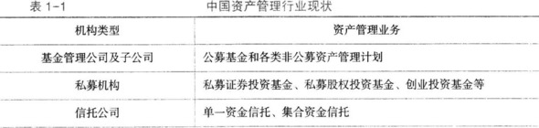
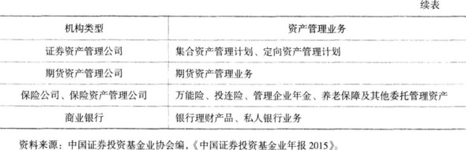

# 基金基础知识与法律法规 · 第1章 金融市场 、资产管理与投资基金

## 第1节 居民理财与金融市场（34题）

**1.（单选题）** 金融的含义是（　）。
A.货币资金的融通
B.实物的融通
C.虚拟资产的融通
D.互联网金融的融通
**答案：** A
**解析：** 所谓金融，简单来讲即【货币资金的融通】。

**2.（单选题）** 目前，居民理财的主要方式有（　）。
①理财②储蓄
③投资④存款
A.①②
B.①③
C.②③
D.③④
**答案：** C
**解析：** 目前，居民理财主要方式是【货币储蓄与投资】两类。

**3.（单选题）** 按交割期限，金融市场分为（　）。
①货币市场②资本市场
③现货市场④期货市场
A.①②
B.①③
C.②③
D.③④
**答案：** D
**解析：** 金融市场按交割期限分为【现货市场和期货市场】。

**4.（单选题）** 按交易性质，金融市场分为（　）。
①发行市场②场内市场
③流通市场④场外市场
A.①②
B.①③
C.②③
D.③④
**答案：** B
**解析：** 金融市场按【交易性质】分为【发行市场和流通市场】。

**5.（单选题）** 以下哪项不是金融市场的主要构成要素（　）。
A.市场参与者
B.交易场所
C.金融工具
D.金融交易的组织方式
**答案：** B
**解析：** 金融市场的主要构成要素包含【市场参与者、金融工具和金融交易的组织方式】。

**6.（单选题）** 金融市场的“市场失灵”问题主要表现不包含（　）。
A.外部性问题
B.脆弱性问题
C.不完全竞争问题
D.完全竞争问题
**答案：** D
**解析：** 金融市场的“市场失灵”问题主要表现为【外部性问题、脆弱性问题、不完全竞争问题和信息不对称问题】。

**7.（单选题）** 在现代居民经济生活中，以下哪项不是现代金融供求的重要组成部分（　）。
A.日常收入、支出活动
B.储蓄
C.投资
D.艺术品收藏
**答案：** D
**解析：** 现代居民经济生活中的【日常收入、支出活动和储蓄、投资等理财活动】构成了现代金融供求的重要组成部分。

**8.（单选题）** 下列不属于金融市场按照不同的交易标的物进行分类的是（　）。
A.货币市场
B.证券市场
C.外汇市场
D.黄金市场
**答案：** A
**解析：** 金融市场按照不同的交易标的物分为【票据市场、证券市场、衍生工具市场、外汇市场、黄金市场】等。

**9.（单选题）** 下列对期货市场交易的说法，正确的是（　）。
A.协议成交和标的交割是同时进行
B.对交易双方来说，利率和汇率风险很小
C.交易对象价格的升降不会影响交易者利润或损失
D.买者和卖者只能依靠自己对市场未来的判断进行交易
**答案：** D
**解析：** A项，期货市场的交易在协议达成后并不立刻交割，而是约定在某一特定时间后进行交割，【协议成交和标的交割是分离的】。
B项，由于期货市场的成交与交割之间有时间间隔，因而对交易双方来说，利率和汇率【风险很大】。
C项，在期货交易中，由于交割要按成交时的协议价格进行，交易对象价格的升降，就可能使交易者获得利润或蒙受损失。

**10.（单选题）** 外汇市场是指各国中央银行、外汇银行、（　）及客户组成的外汇买卖、经营活动的总和。
A.投资银行
B.商业银行
C.外汇经纪人
D.证券交易所
**答案：** C
**解析：** 外汇市场是指各国中央银行、外汇银行、【外汇经纪人】及客户组成的外汇买卖、经营活动的总和，包括外汇批发市场以及银行同企业、个人之间进行外汇买卖的零售市场。

**11.（单选题）** 金融市场是一个（　）。
A.不完全竞争市场
B.完全竞争市场
C.寡头垄断市场
D.完全垄断市场
**答案：** A
**解析：** 金融市场是一个【不完全竞争市场】，金融机构特别是一些大型金融机构存在着一定程度的垄断，对金融市场价格具有一定程度的影响力甚至控制力，金融市场难以实现完全自由竞争。

**12.（单选题）** （　）是货币资金融通市场。
A.金融服务机构
B.基金市场
C.股票市场
D.金融市场
**答案：** D
**解析：** 【金融市场】是货币资金融通市场，是指资金供应者和资金需求者双方通过金融工具进行交易而融通资金的市场。

**13.（单选题）** 下列不属于衍生金融工具的是（　）。
A.远期合约
B.期货合约
C.企业债券
D.互换协议
**答案：** C
**解析：** 衍生金融工具包括【远期合约、期货合约、期权合约、互换协议】等，其种类仍在不断增多。故C项不属于衍生金融工具

**14.（单选题）** 在金融市场的主要构成要素中，以主要资金供应者身份参与金融市场的是（　）。
A.企业
B.个人居民
C.政府
D.金融机构
**答案：** B
**解析：** 金融市场的参与者主要包括政府、中央银行、金融机构、个人和企业居民。其中，【个人居民】是金融市场上主要的资金供给者（选项B符合题意）。个人居民为了预防未来支出的不确定性或出于节俭等目的，将收入的一部分用于储蓄。不少个人居民动用储蓄资金投资于股票、债券、基金等资本市场工具，投资于保险市场或参与黄金市场交易，组合其金融资产，实现风险和收益的最佳匹配。个人居民投资者是金融市场供求均衡的重要力量。

**15.（单选题）** 所谓（　），简单来讲即货币资金的融通。
A.理财
B.金融
C.储蓄
D.投资
**答案：** B
**解析：** 选项B符合题意；所谓金融，简单来讲即货币资金的融通。
选项A不符合题意：理财，指的是对财务进行管理，以实现财产的保值、增值为目的。
选项C不符合题意：储蓄是居民将暂时不用或结余的货币收入存入银行或其他金融机构的一种存款活动。
选项D不符合题意：投资是指投资者当期投入一定数额的资金而期望在未来获得回报，所得回报应该能补偿投资资金被占用的时间、预期的通货膨胀率以及期望更多的未来收益，未来收益具有不确定性。

**16.（单选题）** 根据我国相关法律规定，我国金融监管采取的是银行业、证券业、保险业（　）的模式。
A.统一监管
B.集中监管
C.宏观监管
D.分业监管
**答案：** D
**解析：** 根据我国相关法律规定，我国金融监管采取的是银行业、证券业、保险业【分业监管】的模式。故D项正确

**17.（单选题）** 储蓄的特征是其（　）。
A.保值性
B.不确定性
C.高风险性
D.高回报、低风险性
**答案：** A
**解析：** 储蓄的特征是其【保值性】，接受储蓄的银行或其他金融机构需要首先保证储蓄的本金安全。

**18.（单选题）** （　）是金融市场上最重要的中介机构，是储蓄转化为投资的重要渠道。
A.政府
B.中央银行
C.金融机构
D.企业
**答案：** C
**解析：** 【金融机构】是金融市场上最重要的中介机构，是储蓄转化为投资的重要渠道。

**19.（单选题）** 下列金融市场的监管体系中，（　）对证券业金融机构的业务活动实施监督管理。
A.中国银行业监督管理机构
B.中国证券业监督管理机构
C.中国保险业监督管理机构
D.中国人民银行
**答案：** B
**解析：** 中国银行业监督管理机构、【中国证券业监督管理机构】、中国保险业监督管理机构分别对银行业金融机构、证券业金融机构、保险业金融机构及这些机构的业务活动实施监督管理。

**20.（单选题）** 广义的资本市场不包括（　）。
A.银行中长期存贷款市场
B.票据市场
C.中长期债券市场
D.股票市场
**答案：** B
**解析：** 广义的资本市场包括两大部分：一是【银行中长期存贷款市场】；二是【有价证券市场】，包括中长期债券市场和股票市场。B项属于货币市场。

**21.（单选题）** （　）既是金融市场的中介人，也是金融市场的投资者、货币政策的传递者和承受者，而且在金融市场上具有支配性的作用。
A.企业
B.居民
C.金融机构
D.政府
**答案：** C
**解析：** 金融机构的作用较为特殊，主要表现在以下几个方面：
（1）它是金融市场上最重要的【中介机构】，是储蓄转化为投资的重要渠道；
（2）金融机构在金融市场上充当【资金的供给者、需求者和中间人】等多重角色，它既发行、创造金融工具，也在市场上购买各类金融工具；
（3）既是金融市场的中介人，也是金融市场的投资者、货币政策的传递者和承受者；
（4）金融机构作为机构投资者在金融市场具有支配性的作用。

**22.（单选题）** 债券市场不包括（　）。
A.政府债券的发行市场
B.公司债券的流通市场
C.企业债券的发行市场
D.一级市场
**答案：** D
**解析：** 债券市场包括【政府债券、公司（企业）债券、金融债券】等的发行和流通市场。

**23.（单选题）** 按交易性质划分，金融市场可分为（　）。
A.票据市场和证券市场
B.一级市场和二级市场
C.现货市场和期货市场
D.货币市场和资本市场
**答案：** B
**解析：** 金融市场按【交易性质】分为【发行市场和流通市场】。发行市场，也称一级市场；流通市场，也称二级市场。

**24.（单选题）** 已发行股票的转让流通市场叫做股票（　）。
A.一级市场
B.二级市场
C.初级市场
D.三级市场
**答案：** B
**解析：** 证券市场主要是股票、债券、基金等有价证券发行和转让流通的市场。其中，已发行股票的转让流通市场叫股票【二级市场】。

**25.（单选题）** 下列关于金融工具的说法错误的是（　）。
A.金融工具是金融市场上进行交易的载体
B.金融工具是法律契约，交易双方的权利和义务受法律保护
C.金融工具随时可以流通转让
D.金融工具一般不具有社会可接受性
**答案：** D
**解析：** 金融工具是金融市场上进行交易的载体（选项A正确）。
金融工具一般具有【广泛的社会可接受性】（选项D错误），随时可以流通转让（选项C正确）。
金融工具是法律契约，交易双方的权利和义务受法律保护（选项B正确）。

**26.（单选题）** 资本市场又称为（　）。
A.中期金融市场
B.短期金融市场
C.长期金融市场
D.无期金融市场
**答案：** C
**解析：** 资本市场又称【长期金融市场】，是指以期限在一年以上的有价证券为交易工具进行长期资金交易的市场。

**27.（单选题）** 以下哪一种不是金融交易的组织方式（　）。
A.自由交易方式
B.柜台交易方式
C.交易所交易方式
D.电信网络交易方式
**答案：** A
**解析：** 金融交易的组织方式是指组织金融工具交易时采用的方式。受市场本身的发育程度，交易技术的发达程度以及交易双方的交易意愿影响，金融交易主要有以下组织方式：
（1）【场内交易方式】，指有固定场所、有制度、集中进行交易的方式，如交易所交易方式。
（2）【场外交易方式】，是相对于交易所交易而言的，指在证券交易所之外各金融机构柜台上买卖双方进行面议的、分散交易的方式，如柜台交易方式。
（3）【电信网络交易方式】，指没有固定场所，交易双方也不直接接触，主要借助电子通信或互联网络技术手段来完成交易的方式。

**28.（单选题）** 金融市场参与者中（　）的作用比较特殊。
A.政府
B.中央银行
C.金融机构
D.个人和企业居民
**答案：** C
**解析：** 金融市场参与者中的【金融机构】作用比较特殊。

**29.（单选题）** 由于（　）的成交与交割之间几乎没有时间间隔，因而对交易双方来说，利率和汇率风险很小。
A.现货市场
B.期货市场
C.货币市场
D.资本市场
**答案：** A
**解析：** 由于【现货市场】的成交与交割之间几乎没有时间间隔，因而对交易双方来说，利率和汇率风险很小。

**30.（单选题）** （　）作为机构投资者在金融市场上具有支配地位。
A.政府
B.中央银行
C.金融机构
D.居民
**答案：** C
**解析：** 【金融机构】作为机构投资者在金融市场上具有支配地位。

**31.（单选题）** （　）是指专门融通不超过一年短期资金的场所。
A.资本市场
B.货币市场
C.开放式基金市场
D.股票市场
**答案：** B
**解析：** 金融市场按照交易工具的不同期限分为货币市场和资本市场。其中，【货币市场】又称短期金融市场，是指专门融通【不超过一年】短期资金的场所；资本市场又称长期金融市场，是指以期限在一年以上的有价证券为交易工具进行长期资金交易的市场。

**32.（单选题）** 下列关于金融市场的分类中，不正确的是（　）。
A.按地理范围分为期货市场和现货市场
B.按交易工具的不同期限分为货币市场和资本市场
C.按交易标的物分为票据市场、证券市场、衍生工具市场、外汇市场、黄金市场等
D.按交割期限分为现货市场和期货市场
**答案：** A
**解析：** A项说法错误，金融市场按地理范围分为【国内金融市场和国际金融市场】。

**33.（单选题）** 票据市场是指各种票据进行交易的市场，按（　）主要分为票据承兑市场和贴现市场。
A.交易工具的期限
B.交易标的物
C.交割期限
D.交易方式
**答案：** D
**解析：** 票据市场是指各种票据进行交易的市场，按【交易方式】主要分为【票据承兑市场和贴现市场】。

**34.（单选题）** 金融市场按地理范围分为（　）。
A.期货市场和现货市场
B.有形市场和无形市场
C.国内金融市场和国际金融市场
D.发行市场和流通市场
**答案：** C
**解析：** 金融市场按地理范围分为【国内金融市场和国际金融市场】。

## 第2节 金融资产与资产管理行业（14题）

**1.（单选题）** 资产管理行业的功能描述有错误的是（　）。
A.资产管理行业能够为市场经济体系有效配置资源，使有限的资源配置到最有效率的产品和服务部门，提高整个社会经济的效率和生产服务水平
B.通过资产管理行业专业的管理活动，能够帮助投资人搜集、处理各种和投资有关的宏观、微观信息，提供各类投资机会，帮助投资者进行投资决策，并提供决策的最佳执行服务，使投资融资更加便利
C.资产管理行业创造出十分广泛的投资产品和服务，满足投资者的各种投资需求，使资金的需求方和提供方能够便利地连接起来
D.资产管理行业不能对金融资产进行合理定价，阻碍金融市场提供流动性，提高交易成本
**答案：** D
**解析：** D项描述错误，应为资产管理行业还能【对金融资产进行合理定价】，给金融市场提供流动性，降低交易成本，使金融市场更加健康有效，最终有利于一国经济的发展。

**2.（单选题）** 专业资产管理公司的特点包括（　）。
①主业是资产管理
②不是隶属于银行的独立部门
③不是隶属于保险公司的独立部门
④不是隶属于信托公司的独立部门
A.①②
B.①②③
C.②③
D.②③④
**答案：** B
**解析：** 专业资产管理公司有两个特征：一是【主业是资产管理】；二是【不是隶属于银行或保险公司的独立部门】。多数专业资产管理公司在SEC注册为投资顾问公司，并受SEC监管。故专业资产管理公司的特点不包括第④项。

**3.（单选题）** 在SEC注册的投资公司不包括（　）。
A.共同基金
B.母基金
C.ETF
D.封闭式基金
**答案：** B
**解析：** 在SEC注册的投资公司主要包括【共同基金、交易型开放式指数基金（ETF）、封闭式基金和单位投资信托】。

**4.（单选题）** 从事资产管理业务的金融机构构成资产管理行业，以下不属于资产管理行业的功能和作用的是（　）。
A.为市场经济体系有效配置资源
B.提供各类投资机会
C.对金融资产合理定价
D.防范风险
**答案：** D
**解析：** 资产管理行业无论对宏观经济还是微观的个人、企业都有着重要的功能和作用：
(1)资产管理行业能够为市场经济体系有效配置资源，使有限的资源配置到最有效率的产品和服务部门，提高整个社会经济的效率和生产服务水平。（选项A属于）
(2)通过资产管理行业专业的管理活动，能够帮助投资人搜集、处理各种和投资有关的宏观、微观信息，提供各类投资机会，帮助投资者进行投资决策，并提供决策的最佳执行服务，使投资融资更加便利。（选项B属于）
(3)资产管理行业创造出十分广泛的投资产品和服务，满足投资者的各种投资需求，使资金的需求方和提供方能够便利地连接起来。
(4)资产管理行业还能对金融资产进行合理定价，给金融市场提供流动性，降低交易成本，使金融市场更加健康有效，最终有利于一国经济的发展。（选项C属于）
D项属于衍生金融工具的作用。

**5.（单选题）** （　）是指投资人承担最终的收益和风险，不存在保底保收益等“刚性兑付”。
A.“卖者有责”
B.“买者自负”
C.“买者有责”
D.“卖者自负”
**答案：** B
**解析：** 【“买者自负”】是指投资人承担最终的收益和风险，不存在保底保收益等“刚性兑付”。故B项说法正确

**6.（单选题）** （　）类金融资产以票据、债券等契约型投资工具为主。
A.债券
B.股权
C.证券
D.实物
**答案：** A
**解析：** 金融资产是代表未来收益或资产合法要求权的凭证，标示了明确的价值，表明了交易双方的所有权关系和债权关系。一般分为债券类金融资产和股权类金融资产。【债券类】金融资产以【票据、债券】等契约型投资工具为主，股权类金融资产以各类股票为主。

**7.（单选题）** 以下关于资产管理活动说法错误的是（　）。
A.对储蓄而言，存款人与银行是债权人和债务人关系
B.对资产管理而言，投资人与管理人是委托人和受托人关系
C.投资人自担风险、自享收益
D.管理人与投资人共担风险，共享收益
**答案：** D
**解析：** 对储蓄而言，存款人与银行是债权人和债务人关系，银行必须按照约定到期偿还本金，支付利息；（选项A说法正确）
对资产管理而言，投资人与管理人是委托人和受托人关系，（选项B说法正确）投资人【自担风险、自享收益】，（选项C说法正确）管理人只作为管理顾问收取一定比例的管理费。（选项D说法错误）

**8.（单选题）** （　）金融研究办公室发布的《资产管理与金融稳定报告》对资产管理行业涉及的范围进行了详细的划分。
A.美国财政部
B.英国财政部
C.美国银行
D.中央银行
**答案：** A
**解析：** 【美国财政部】金融研究办公室发布的《资产管理与金融稳定报告》对资产管理行业涉及的范围进行了详细的划分。

**9.（单选题）** （　）要求管理人应当以实现投资人利益为最高目的，将自身的利益妥善置于投资人利益之下，不得与投资人利益发生冲突。
A.忠诚义务
B.诚信义务
C.公开义务
D.专业义务
**答案：** A
**解析：** 资产管理人必须尽到“诚实信用、勤勉尽责”的信托责任，恪守忠诚与专业义务。【忠诚义务】要求管理人应当以实现投资人利益为最高目的，将自身的利益妥善置于投资人利益之下，不得与投资人利益发生冲突。

**10.（单选题）** 以下不属于资产管理的本质的是（　）。
A.一切资产管理活动都要求风险与收益相匹配
B.管理人必须坚持“卖者有责”
C.管理人必须保证投资者收益
D.投资人必须做到“买者自负”
**答案：** C
**解析：** 资产管理的本质具体表现为一切资产管理活动都要求风险与收益相匹配、管理人必须坚持【“卖者有责”】、投资人必须做到【“买者自负”】。

**11.（单选题）** （　）要求管理人应当具备专业的投资管理和运作能力，充分发挥专业投资管理价值。
A.忠诚义务
B.诚信义务
C.公开义务
D.专业义务
**答案：** D
**解析：** 【专业义务】要求管理人应当具备专业的投资管理和运作能力，充分发挥专业投资管理价值。

**12.（单选题）** 资产管理的特点不包括（　）。
A.受托资产主要是货币等金融资产
B.资产管理包括委托方和受托方
C.帮助投资者进行投资决策，并提供决策的最佳执行服务
D.通过投资于银行存款、证券、期货、基金、保险或实体企业股权以及其他可被证券化的资产实现增值
**答案：** C
**解析：** 资产管理具有以下特征：
(1)从参与方来看，资产管理包括【委托方和受托方】，委托方为投资者，受托方为资产管理人。资产管理人根据投资者授权，进行资产投资管理，承担受托人义务。
(2)从受托资产来看，主要为【货币等金融资产】，一般不包括固定资产等实物资产。
(3)从管理方式来看，资产管理主要通过投资于【银行存款、证券、期货、基金、保险、实体企业股权以及其他可被证券化的资产】实现增值。
C项属于资产管理的功能和作用，不属于资产管理的特点，故选C。

**13.（单选题）** 美国资产管理机构之一银行，通过独立账户或银行共同信托基金和集合投资基金，为客户提供投资基金、财富管理、信托服务、退休产品等服务。此项业务属于银行的（　）。
A.资产业务
B.负债业务
C.表外业务
D.代理业务
**答案：** C
**解析：** 美国财政部金融研究办公室发布的《资产管理与金融稳定报告》对资产管理行业涉及的范围进行了详细划分，其中，银行通过独立账户或银行共同信托基金和集合投资基金，为客户提供投资基金、财富管理、信托服务、退休产品等服务的业务属于【表外业务】（C项符合题意），受美联储监管，同时豁免在美国证监会注册，除非投资于在美国证券交易委员会注册的投资公司。

**14.（单选题）** 资产管理具有（　）特征。
A.使有限的资源得到有效的利用
B.从参与方来看，资产管理包括委托方和受托方
C.帮助投资者进行投资决策，并提供决策的最佳执行服务
D.给金融市场提供流动性，减少交易成本
**答案：** B
**解析：** 资产管理具有以下特征：
(1)从参与方来看，资产管理包括【委托方和受托方】，委托方为投资者，受托方为资产管理人。资产管理人根据投资者授权，进行资产投资管理，承担受托人义务。
(2)从受托资产来看，主要为货币等金融资产，一般不包括固定资产等实物资产。
(3)从管理方式来看，资产管理主要通过投资于银行存款、证券、期货、基金、保险、实体企业股权以及其他可被证券化的资产实现增值。

## 第3节 中国资产管理行业的状况（31题）

**1.（单选题）** 我国期货公司为单一客户办理的资产管理业务起始委托资产不得低于（　）。
A.100万元
B.50万元
C.200万元
D.300万元
**答案：** A
**解析：** 期货公司及其子公司从事资产管理业务包括为单一客户办理资产管理业务和为特定多个客户办理资产管理业务。资产管理业务的客户应当具有较强资金实力和风险承受能力，单一客户的起始委托资产不得低于【100万】元人民币。

**2.（单选题）** 资产管理业务回归本源，本源的含义是（　）。
A.卖者尽责，买者自负
B.风险共担，利益共享
C.受人之托，代人理财
D.集合理财，分散风险
**答案：** C
**解析：** 资产管理业务回归【“受人之托，代人理财”】的本源，投资产生的收益和风险均应由投资者享有和承担，委托人只收取相应的管理费用。

**3.（单选题）** 以下关于金融去杠杆说法正确的是（　）。
A.金融去杠杆首先抑制经济增长，而非压缩资产泡沫
B.金融去杠杆首先压缩资产泡沫，而非抑制经济增长
C.金融去杠杆只为抑制经济增长
D.金融去杠杆只为压缩资产泡沫
**答案：** B
**解析：** 选项B说法正确：建立健全独立的账户管理和托管制度，充分隔离不同资产管理产品之间以及资产管理机构自有资金和受托管理资金之间的风险，统一同类产品的杠杆率，合理控制股票市场、债券市场杠杆水平，抑制资产泡沫。金融去杠杆【首先压缩资产泡沫】，而非抑制经济增长；金融去杠杆【首先作用于同业链条】，压缩资产泡沫，对实体经济的影响相对温和。

**4.（单选题）** 以下关于私募基金合格投资者的说法正确的有（　）。
Ⅰ、净资产不低于1000万元的单位
Ⅱ、金融资产不低于300万元的个人
Ⅲ、3年个人年均收入不低于50万元的个人
Ⅳ、投资于单只私募基金的金额不低于50万元
A.Ⅰ、Ⅱ、Ⅲ、Ⅳ
B.Ⅰ、Ⅲ、Ⅳ
C.Ⅱ、Ⅲ、Ⅳ
D.Ⅰ、Ⅱ、Ⅲ
**答案：** D
**解析：** 非公开募集基金应当向合格投资者募集，合格投资者累计不得超过200人。合格投资者是指具备相应风险识别和承担能力，投资于单只私募基金的金额不低于【100万】元且符合下列相关标准的单位和个人：
①净资产不低于【1000万】元的单位；
②金融资产不低于【300万】元或者最近【3年】个人年均收入不低于【50万】元的个人。
金融资产包括银行存款、股票、债券、基金份额、资产管理计划、银行理财产品、信托计划、保险产品、期货权益等。

**5.（单选题）** 以下关于产品多层嵌套导致风险传递的说法错误的是（　）。
A.嵌套产品结构复杂，底层资产难以穿透，一旦发生风险，将影响各参与机构，增加风险传递的可能性，加剧市场波动
B.多层嵌套的资产管理产品夹杂多层法律关系，如果委托机构主动管理缺失，通道机构尽职调查能力不足，发生损失时也容易出现责任推诿
C.一些互联网平台、民间理财等未受到有效监管的非金融机构与金融机构合作进行产品嵌套，风险不容忽视
D.在不愿放弃优质项目的情况下，一些银行理财以信托、股权、基金、保险资产管理产品为通道，将资金投向债权等产品
**答案：** D
**解析：** 银行理财拥有大量资金来源，投资范围基本局限于债权，股权投资受到一定限制，且不能做分级产品设计。在不愿放弃优质项目的情况下，一些银行理财以信托、证券、基金、保险资产管理产品为通道，将资金投向【股权】等产品。（选项D说法错误）
嵌套产品结构复杂，底层资产难以穿透，一旦发生风险，将影响各参与机构，增加风险传递的可能性，加剧市场波动。（选项A说法正确）
多层嵌套的资产管理产品夹杂多层法律关系，如果委托机构主动管理缺失，通道机构尽职调查能力不足，发生损失时也容易出现责任推诿。（选项B说法正确）
此外，一些互联网平台、民间理财等未受到有效监管的非金融机构与金融机构合作进行产品嵌套，风险不容忽视。（选项C说法正确）

**6.（单选题）** （　），是指保险资产管理公司等专业管理机构作为受托人设立支持计划，以基础资产产生的现金流为偿付支持，面向保险机构等合格投资者发行受益凭证的业务活动。
A.资产支持计划业务
B.私募基金业务
C.保险资产管理产品业务
D.保险资金委托投资业务
**答案：** A
**解析：** 【资产支持计划业务】是指保险资产管理公司等专业管理机构作为受托人设立支持计划，以基础资产产生的现金流为偿付支持，面向保险机构等合格投资者发行受益凭证的业务活动。

**7.（单选题）** 按照客户获取收益方式的不同，理财计划可以分为（　）。
A.保本浮动收益理财计划和非保本浮动收益理财计划
B.固定利率理财计划和浮动利率理财计划
C.保证收益理财计划和非保证收益理财计划
D.保证收益理财计划和保本浮动收益理财计划
**答案：** C
**解析：** 按照客户【获取收益方式】的不同，理财计划可以分为【保证收益理财计划和非保证收益理财计划】，非保证收益理财计划可以分为保本浮动收益理财计划和非保本浮动收益理财计划。

**8.（单选题）** 下列属于保险公司、保险资产管理公司的资产管理业务的是（　）。
A.管理企业年金
B.公募基金资产管理计划
C.银行理财产品
D.集合资产管理计划
**答案：** A
**解析：** 

**9.（单选题）** 关于保本浮动收益理财计划，下列说法正确的是（　）。
A.指商业银行在对潜在目标客户群分析研究的基础上，针对特定目标客户群开发设计并销售的资金投资和管理计划
B.指商业银行按照约定条件向客户保证本金支付，本金以外的投资风险由客户承担，并依据实际投资收益情况确定客户实际收益的理财计划
C.指商业银行根据约定条件和实际投资收益情况向客户支付收益，并不保证客户本金安全的理财计划
D.指商业银行按照约定条件向客户承诺支付固定收益，银行承担由此产生的投资风险，或银行按照约定条件向客户承诺支付最低收益并承担相关风险，其他投资收益由银行和客户按照合同约定分配，并共同承担相关投资风险的理财计划
**答案：** B
**解析：** A项说法错误，描述的是“理财计划”。
B项说法正确，“保本浮动收益理财计划”是指商业银行按照约定条件向客户保证本金支付，本金以外的投资风险由客户承担，并依据实际投资收益情况确定客户实际收益的理财计划。
C项说法错误，描述的是“非保本浮动收益理财计划”。
D项说法错误，描述的是“保证收益理财计划”。

**10.（单选题）** 下列关于我国的资产管理行业说法错误的是（　）。
A.“卖者有责、买者自负”的行业基础文化有待形成
B.与国际一流资产管理机构相比，我国的资产管理机构仍存在不小的差距
C.核心竞争力、诚信守规意识与风险控制能力比较完善
D.法律及监管框架、监管能力有待完善和提高
**答案：** C
**解析：** 我国的资管行业仍处于发展的初级阶段，“卖者有责、买者自负”的行业基础文化有待形成；与国际一流资产管理机构相比，我国的资产管理机构仍存在不小的差距，核心竞争力、诚信守规意识与风险控制能力亟待提升；法律及监管框架、监管能力【有待完善和提高】。故C项说法错误

**11.（单选题）** 以下关于促进资产管理业务规范健康发展的方法包括（　）。
Ⅰ、引导资产管理业务回归本源，有序打破刚性兑付
Ⅱ、建立综合统计制度，为穿透式监管提供根本基础
Ⅲ、加强“非标”业务管理，防范影子银行风险
Ⅳ、分类统一标准规则，逐步消除套利空间
A.Ⅰ、Ⅱ、Ⅲ、Ⅳ
B.Ⅰ、Ⅱ、Ⅲ
C.Ⅱ、Ⅲ、Ⅳ
D.Ⅰ、Ⅱ、Ⅳ
**答案：** A
**解析：** 促进资产管理业务规范健康发展的方法包括：
（1）分类统一标准规则，逐步消除套利空间。（Ⅳ包括）
（2）引导资产管理业务回归本源，有序打破刚性兑付。（Ⅰ包括）
（3）加强流动性风险管控，控制杠杆水平。
（4）消除多层嵌套，抑制通道业务。
（5）加强“非标”业务管理，防范影子银行风险。（Ⅲ包括）
（6）建立综合统计制度，为穿透式监管提供根本基础。（Ⅱ包括）

**12.（单选题）** 关于资产管理行业的现状，下列表述错误的是（　）。
A.银行、保险等各类机构不能开展资产管理业务
B.随着我国国民个人财富的不断积累，投资者对理财的需求不断上升
C.传统的资产管理行业主要是基金管理公司和信托公司
D.各类机构广泛参与、各类资产管理业务交叉融合是我国目前资产管理行业的现状
**答案：** A
**解析：** 在我国，传统的资产管理行业【主要是基金管理公司和信托公司】。近年来，随着我国居民个人财富的不断积累，金融监管机构对资产管理的金融管制逐渐放松，投资者对理财的需求不断上升，银行、证券、保险等各类金融机构纷纷开展资产管理业务，除公募基金、私募基金、信托计划外，还提供券商资管、保险资管、期货资管、银行理财等各种资产管理产品。分处不同监管体系的各类机构广泛参与、各类资产管理业务交叉融合所形成的既相似又不同的混业局面，是我国目前资产管理行业的现状。故A项说法错误

**13.（单选题）** 信托公司设立集合资金信托计划，应当符合的要求包括（　）。
Ⅰ、委托人为合格投资者
Ⅱ、参与信托计划的委托人为唯一受益人
Ⅲ、信托期限不少于2年
Ⅳ、信托受益权划分为等额份额的信托单位
A.Ⅰ、Ⅲ、Ⅳ
B.Ⅰ、Ⅱ、Ⅳ
C.Ⅰ、Ⅱ、Ⅲ
D.Ⅰ、Ⅱ、Ⅲ、Ⅳ
**答案：** B
**解析：** 信托公司设立集合资金信托计划，应当符合以下要求：
（1）委托人为合格投资者；（Ⅰ包括）
（2）参与信托计划的委托人为唯一受益人；（Ⅱ包括）
（3）单个信托计划的自然人人数不得超过50人，但单笔委托金额在300万元以上的自然人投资者和合格的机构投资者数量不受限制；
（4）信托期限不少于【1年】；（Ⅲ错误）
（5）信托资金有明确的投资方向和投资策略，且符合国家产业政策以及其他有关规定；
（6）信托受益权划分为等额份额的信托单位；（Ⅳ包括）
（7）信托合同应约定受托人报酬，除合理报酬外，信托公司不得以任何名义直接或间接以信托财产为自己或他人牟利；
（8）银保监会规定的其他要求。

**14.（单选题）** 私人银行客户是指金融净资产达到（　）人民币及以上的商业银行客户。
A.600万元
B.500万元
C.300万元
D.100万元
**答案：** A
**解析：** 私人银行客户是指金融净资产达到【600万】元人民币及以上的商业银行客户。

**15.（单选题）** 非金融机构开展资产管理业务已经暴露出一些风险和问题不包括（　）。
A.打击虚假误导宣传，充分揭示投资风险
B.将线下私募发行的资产管理产品通过线上分拆向非特定公众销售
C.向不具有风险识别能力的投资者推介产品，或未充分采取技术手段识别客户身份
D.未采取资金托管等方式保障投资者资金安全，甚至演变为非法集资
**答案：** A
**解析：** 非金融机构开展资产管理业务已经暴露出一些风险和问题。例如，将线下私募发行的资产管理产品通过线上分拆向非特定公众销售；向不具有风险识别能力的投资者推介产品，或未充分采取技术手段识别客户身份；开展虚假误导宣传，【未充分揭示投资风险】；未采取资金托管等方式保障投资者资金安全，甚至演变为非法集资。故A项符合题意

**16.（单选题）** 以下关于促进资产管理业务规范健康发展的说法错误的是（　）。
A.针对影子银行风险，要建立资产管理业务的宏观审慎政策框架，完善政策工具，从宏观、逆周期、跨市场的角度加强监测、评估和调节
B.资产管理业务回归“受人之托、代人理财”的本源，投资产生的收益和风险均应由投资者享有和承担，只收取委托人相应的管理费用
C.同类产品的杠杆率也应当分离，才能合理控制股票市场、债券市场杠杆水平，抑制资产泡沫
D.控制并逐步缩减“非标”投资规模，加强投前尽职调查、风险审查和投后风险管理
**答案：** C
**解析：** 强化单独管理、单独建账、单独核算要求，使产品期限与所投资资产存续期相匹配。鼓励金融机构设立具有独立法人地位的子公司专门开展资产管理业务。建立健全独立的账户管理和托管制度，充分隔离不同资产管理产品之间以及资产管理机构自有资金和受托管理资金之间的风险。【统一同类产品的杠杆率】，合理控制股票市场、债券市场杠杆水平，抑制资产泡沫。故C项说法错误

**17.（单选题）** 商业银行为私人银行客户和高资产净值客户提供理财产品销售服务应当进行客户（　）评估。
A.风险承受能力
B.资金收入能力
C.期望收益
D.投资偏好
**答案：** A
**解析：** 商业银行为私人银行客户和高资产净值客户提供理财产品销售服务应当进行客户【风险承受能力】评估。

**18.（单选题）** 银行表外理财，银信合作、银证合作、银基合作中投向非标准化债权类资产（以下简称“非标”）的产品，保险机构“名股实债”类投资等，具有（　）特征。
A.隐性刚性兑付
B.影子银行
C.杠杆效应
D.无序循环
**答案：** B
**解析：** 银行表外理财，银信合作、银证合作、银基合作中投向非标准化债权类资产（以下简称“非标”）的产品，保险机构“名股实债”类投资等，具有【影子银行】特征。

**19.（单选题）** 针对影子银行风险，需要改善的是（　）。
A.加强投资者适当性管理和投资者教育，强化“卖者尽责、买者自负”的投资理念
B.强化单独管理、单独建账、单独核算要求，使产品期限与所投资资产存续期相匹配
C.强化功能监管和穿透式监管，同类产品适用不同标准，消除套利空间，有效遏制产品嵌套导致的风险传递
D.建立资产管理业务的宏观审慎政策框架，完善政策工具，从宏观、逆周期、跨市场的角度加强监测、评估和调节
**答案：** D
**解析：** 针对影子银行风险，要建立资产管理业务的宏观审慎政策框架，完善政策工具，从宏观、逆周期、跨市场的角度加强监测、评估和调节。故D项符合题意

**20.（单选题）** 商业银行高资产净值客户应符合的条件不包括（　）。
A.单笔认购理财产品不少于100万元人民币的自然人
B.认购理财产品时，个人或家庭金融净资产总计超过100万元人民币，且能提供相关证明的自然人
C.金融净资产达到600万元人民币及以上
D.个人收入在最近三年每年超过20万元人民币或者家庭合计收入在最近3年内每年超过30万元人民币，且能提供相关证明的自然人
**答案：** C
**解析：** 高资产净值客户是指符合下列条件之一的商业银行客户：
（1）单笔认购理财产品不少于【100万】元人民币的自然人。（选项A包括）
（2）认购理财产品时，个人或家庭金融净资产总计超过【100万】元人民币，且能提供相关证明的自然人。（选项B包括）
（3）个人收入在【最近三年】每年超过【20万】元人民币或者家庭合计收入在最近3年内每年超过【30万】元人民币，且能提供相关证明的自然人。（选项D包括）
C项描述的是：“私人银行客户”是指金融净资产达到600万元人民币及以上的商业银行客户。

**21.（单选题）** 公开募集基金，应当经（　）注册，未经注册，不得公开或者变相公开募集基金。
A.证券交易所
B.中国证券业协会
C.国务院证券监督管理机构
D.国务院
**答案：** C
**解析：** 公开募集基金，应当经【国务院证券监督管理机构】注册，未经注册，不得公开或者变相公开募集基金。

**22.（单选题）** 保险资金可以设立（　），范围包括成长基金、并购基金、新兴战略产业基金、夹层基金、不动产基金、创业投资基金及以上述基金为主要投资对象的母基金。
A.资产支持计划业务
B.公募证券投资基金
C.私募基金
D.保险资产管理产品业务
**答案：** C
**解析：** 保险资金可以设立【私募基金】，范围包括成长基金、并购基金、新兴战略产业基金、夹层基金、不动产基金、创业投资基金及以上述基金为主要投资对象的母基金。

**23.（单选题）** 下列关于期货公司及其子公司从事资产管理业务的说法错误的是（　）。
A.资产管理计划的资产委托人应当为合格投资者
B.可以为单一客户和特定多个客户办理资产管理业务
C.单一客户的起始委托资产不低于100万
D.单个资产管理计划的投资人数需超过200人
**答案：** D
**解析：** 期货公司及其子公司从事资产管理业务包括为单一客户办理资产管理业务和为特定多个客户办理资产管理业务。资产管理业务的客户应当具有较强资金实力和风险承受能力，单一客户的起始委托资产【不得低于100万】元人民币。资产管理计划的资产委托人应当为合格投资者，单个资产管理计划的投资者人数【不得超过200人】。合格投资者应当符合《私募投资基金监督管理暂行办法》的有关规定。

**24.（单选题）** 集合资金信托计划，是由（　）担任受托人，按照委托人意愿，为受益人的利益，将两个及以上委托人交付的资金进行集中管理、运用或处分的资金信托业务活动。
A.证券公司
B.信托公司
C.期货公司
D.证券服务机构
**答案：** B
**解析：** 集合资金信托计划，是由【信托公司】担任受托人，按照委托人意愿，为受益人的利益，将两个及以上委托人交付的资金进行集中管理、运用或处分的资金信托业务活动。

**25.（单选题）** 私募机构资产管理业务中，下列投资者不可以视为合格投资者的是（　）。
A.社会保障基金、企业年金等养老基金，慈善基金等社会公益基金
B.依法设立并在基金业协会备案的投资计划
C.信托投资基金、保险基金
D.投资于所管理私募基金的私募基金管理人及其从业人员
**答案：** C
**解析：** 私募机构资产管理业务中，下列投资者视为合格投资者：
（1）社会保障基金、企业年金等养老基金，慈善基金等社会公益基金。（选项A包括）
（2）依法设立并在基金业协会备案的投资计划。（选项B包括）
（3）投资于所管理私募基金的私募基金管理人及其从业人员。（选项D包括）
（4）中国证监会规定的其他投资者。

**26.（单选题）** （　）是指基金管理公司设立专门的子公司，投资于未通过证券交易所转让的股权、债权及其他财产权利以及中国证监会认可的其他资产的特定资产管理计划。
A.公开募集基金
B.特定客户资产管理业务
C.专项资产管理计划
D.私募股权投资基金
**答案：** C
**解析：** 【专项资产管理计划】，是指基金管理公司设立专门的子公司，投资于未通过证券交易所转让的股权、债权及其他财产权利以及中国证监会认可的其他资产的特定资产管理计划。

**27.（单选题）** 下列不属于证券公司可以设立的子公司有（　）。
A.私募投资基金子公司
B.证券公司另类子公司
C.证券资产管理子公司
D.保险资产管理公司
**答案：** D
**解析：** 根据《证券公司私募投资基金子公司管理规范》《证券公司另类投资子公司管理规范》的规定，证券公司也可以设立【私募投资基金子公司】从事私募投资基金业务，还可以设立【证券公司另类子公司】，从事《证券公司证券自营投资品种清单》所列品种以外的金融产品、股权等另类投资业务。目前我国已有一些证券公司及其【资产管理子公司】得到核准，开展公募基金管理业务。

**28.（单选题）** 基金管理公司为多个客户办理特定资产管理业务的，客户委托的初始资产合计不得低于（　）人民币。
A.1000万元
B.2000万元
C.3000万元
D.5000万元
**答案：** C
**解析：** 基金管理公司为多个客户办理特定资产管理业务的，客户委托的初始资产合计不得低于【3000万】元人民币。

**29.（单选题）** 以下关于证券公司从事的资产管理业务说法正确的是（　）。
A.个人或者家庭金融资产合计不低于300万元人民币
B.公司、企业等机构净资产不低于3000万元人民币
C.集合资产管理计划的合格投资者累计不得超过200人
D.合格投资者仅指具备相应风险识别能力和承担所投资集合资产管理计划风险能力
**答案：** C
**解析：** 证券公司资产管理业务的合格投资者是指具备相应风险识别能力和承担所投资集合资产管理计划风险能力且符合下列条件之一的单位和个人：
（1）个人或者家庭金融资产合计不低于【100万】元人民币。
（2）公司、企业等机构净资产不低于【1000万】元人民币。
集合资产管理计划应当面向合格投资者推广，合格投资者累计不得超过【200人】。故C项说法正确

**30.（单选题）** 以下关于基金管理公司及其子公司资产管理业务说法正确的有（　）。
A.基金管理公司从事公开募集基金业务，向特定对象募集资金累计不得超过200人
B.基金管理公司通过设立资产管理计划从事特定资产管理业务，可以采取为单一客户办理特定资产管理业务以及为特定的多个客户办理特定资产管理业务
C.为单一客户办理特定资产管理业务的，客户委托的初始资产不得低于2000万元人民币
D.为多个客户办理特定资产管理业务的，客户委托的初始资产合计不得低于1000万元人民币，但不得超过10亿元人民币
**答案：** B
**解析：** 基金管理公司从事【特定客户资产管理】，向特定对象募集资金累计不得超过【200人】。（选项A错误）
基金管理公司通过设立资产管理计划从事特定资产管理业务，可以采取为单一客户办理特定资产管理业务以及为特定的多个客户办理特定资产管理业务两种形式。（选项B正确）
为单一客户办理特定资产管理业务的，客户委托的初始资产不得低于【3000万】元人民币。（选项C错误）
为多个客户办理特定资产管理业务的，客户委托的初始资产合计不得低于【3000万】元人民币，但不得超过【50亿】元人民币。（选项D错误）

**31.（单选题）** 以下不是私募机构资产管理业务的范围的是（　）。
A.私募证券投资基金
B.创业投资基金
C.私募股权投资基金
D.私募债权投资基金
**答案：** D
**解析：** 私募基金管理机构可以从事【私募证券投资基金、私募股权投资基金、创业投资基金】等募集和管理业务。故D项符合题意

## 第4节 投资基金简介（19题）

**1.（单选题）** 公募基金行业规范的内容不包括（　）。
A.信息披露
B.投资者的投资能力
C.利润分配
D.投资限制
**答案：** B
**解析：** 公募基金是向不特定投资者公开发行受益凭证进行资金募集的基金，公募基金一般在法律和监管部门的严格监管下，有着【信息披露、利润分配、投资限制】等行业规范。
私募基金是私下或直接向特定投资者募集的资金，私募基金只能向少数特定投资者采用非公开方式募集，对投资者的投资能力有一定的要求，同时在信息披露、投资限制等方面监管要求较低，方式较为灵活。

**2.（单选题）** 股权投资基金又称（　）。
A.私人股权投资基金
B.证券投资基金
C.股权类投资基金
D.风险投资基金
**答案：** A
**解析：** 股权投资基金，又称【“私人股权投资基金”或“私募股权投资基金”】。

**3.（单选题）** 投资基金是一种（　）。
A.直接投资工具
B.间接投资工具
C.直接和间接相结合的投资工具
D.混合投资工具
**答案：** B
**解析：** 投资基金是一种【间接投资工具】。

**4.（单选题）** 与其他金融工具相比较，投资基金是一种（　）。
A.债权凭证
B.收益凭证
C.信用凭证
D.受益凭证
**答案：** D
**解析：** 投资基金是资产管理的主要方式之一，它是一种组合投资、专业管理、利益共享、风险共担的集合投资方式。它主要通过向投资者发行【受益凭证(基金份额)】，将社会上的资金集中起来，交由专业的基金管理机构投资于各种资产，实现保值增值。

**5.（单选题）** 将投资基金分为契约型、公司型、有限合伙型等形式是按照（　）划分的。
A.资金募集方式
B.法律形式
C.运作方式
D.所投资的对象的不同
**答案：** B
**解析：** 投资基金按照不同的标准可以区分为多种类别：
①按照资金募集方式，可以分为公募基金和私募基金两类。
②按照【法律形式】，可以分为【契约型、公司型、有限合伙型】等形式。
③按照运作方式，可以分为开放式基金、封闭式基金。

**6.（单选题）** （　）是基于投资理论和极其复杂的金融市场操作技巧，充分利用各种金融衍生产品的杠杆效用，承担高风险、追求高收益的投资模式。
A.风险投资基金
B.证券投资基金
C.另类投资基金
D.对冲基金
**答案：** D
**解析：** 【对冲基金】是基于投资理论和极其复杂的金融市场操作技巧，充分利用各种金融衍生产品的杠杆效用，承担高风险、追求高收益的投资模式。

**7.（单选题）** 下列关于我国证券投资基金的表述，不正确的是（　）。
A.投资者通过购买基金份额方式直接进行证券投资
B.每只基金都有一个基金合同
C.证券投资基金是一种间接投资工具
D.证券投资基金通过发行基金份额方式募集
**答案：** A
**解析：** A项说法错误，投资者通过购买基金份额方式【间接】进行证券投资。

**8.（单选题）** （　）是资产管理的主要方式之一，它是一种组合投资、专业管理、利益共享、风险共担的集合投资方式。
A.投资基金
B.信托管理
C.投资债券
D.证券理财
**答案：** A
**解析：** 【投资基金】是资产管理的主要方式之一，它是一种组合投资、专业管理、利益共享、风险共担的集合投资方式。

**9.（单选题）** 投资于传统的股票、债券外的金融和实物资产的基金指的是（　）。
A.另类投资基金
B.证券投资基金
C.对冲基金
D.私募股权基金
**答案：** A
**解析：** A项符合题意：另类投资基金，是指投资于传统的股票、债券外的金融和实物资产的基金，如房地产、证券化资产、对冲基金、大宗商品、黄金、艺术品等。
B不项符合题意：证券投资基金是依照利益共享、风险共担的原则，将分散在投资者手中的资金集中起来委托专业投资机构进行证券投资管理的投资工具。
C项不符合题意：对冲基金，意为“风险对冲过的基金”，它是基于投资理论和极其复杂的金融市场操作技巧，充分利用各种金融衍生产品的杠杆效用，承担高风险、追求高收益的投资模式。
D项不符合题意：私募股权基金是指对非上市企业进行的权益性投资，在交易实施过程中附带考虑了将来的退出机制，即通过上市、并购或管理层回购等方式，出售持股获利。

**10.（单选题）** 下列描述中属于描述对冲基金的是（　）。
A.是基于投资理论和极其复杂的金融市场操作技巧，充分利用各种金融衍生产品的杠杆效用，承担高风险、追求高收益的投资模式
B.是投资于传统的股票、债券之外的金融和实物资产的基金
C.以一定的方式吸收机构和个人的资金，投向于那些不具备上市资格的初创期的或者是小型的新型企业
D.是对非上市企业进行的权益性投资
**答案：** A
**解析：** A项符合题意，对冲基金，意为“风险对冲过的基金”，它是基于投资理论和极其复杂的金融市场操作技巧，充分利用各种金融衍生产品的杠杆效用，承担高风险、追求高收益的投资模式。
B项描述的是“另类投资基金”，C项描述的是“风险投资基金”，D项描述的是“私募股权投资基金”。

**11.（单选题）** 公募基金和私募基金是将投资基金按照（　）标准进行的分类。
A.法律形式
B.资金募集方式
C.投资对象
D.运作方式
**答案：** B
**解析：** 投资基金按照不同的标准可以区分为多种类别：
①按照【资金募集方式】，可以分为【公募基金和私募基金】两类。
②按照法律形式，可以分为契约型、公司型、有限合伙型等形式。
③按照运作方式，可以分为开放式基金、封闭式基金。

**12.（单选题）** （　），以一定的方式吸收机构和个人的资金，投向于那些不具备上市资格的初创期的或者是小型的新型企业，尤其是高新技术企业，帮助所投资的企业尽快成熟，取得上市资格，从而使资本增值。
A.证券投资基金
B.风险投资基金
C.对冲基金
D.另类投资基金
**答案：** B
**解析：** 【风险投资基金】，又叫创业基金，也可以看作私募股权基金的一种，它以一定的方式吸收机构和个人的资金，投向于那些不具备上市资格的初创期的或者是小型的新型企业，尤其是高新技术企业，帮助所投资的企业尽快成熟，取得上市资格，从而使资本增值。

**13.（单选题）** 目前，共有（　）多个国家和地区建立了不动产投资基金（REITs）制度体系。
A.10
B.15
C.20
D.30
**答案：** D
**解析：** 目前共有【30】多个国家和地区建立了REITs制度体系。除美国外，澳大利亚、日本、新加坡与我国香港的REITs市场发展较好。

**14.（单选题）** 下列关于公募基金和私募基金的募集方式及监管要求的说法中，错误的是（　）。
A.公募基金可以向不特定投资者公开募集资金
B.公募基金在法律和监管部门的严格监管下，有信息披露、利润分配等行业规范
C.私募基金在信息披露、投资限制等方面监管要求较低，方式较为灵活
D.私募基金也可向不特定投资者公开募集资金
**答案：** D
**解析：** 私募基金是私下或直接向【特定投资者】募集的资金，私募基金只能向少数特定投资者采用【非公开方式】募集，对投资者的投资能力有一定的要求，同时在信息披露、投资限制等方面监管要求较低，方式较为灵活。故D项说法错误

**15.（单选题）** 风险投资基金又被称为（　）。
A.封闭式基金
B.开放式基金
C.创业基金
D.对冲基金
**答案：** C
**解析：** 风险投资基金，又叫【创业基金】，也可以看作私募股权基金的一种，它以一定的方式吸收机构和个人的资金，投向于那些不具备上市资格的初创期的或者是小型的新型企业，尤其是高新技术企业，帮助所投资的企业尽快成熟，取得上市资格，从而使资本增值。

**16.（单选题）** 下列表述中，属于私募基金的特征的是（　）。
A.在信息披露、投资限制等方面没有监管要求，方式非常灵活
B.私募基金的法律形式均为有限合伙型
C.只能向特定投资者募集资金
D.对投资者的家庭财务水平有一定要求，对投资者能力没有要求
**答案：** C
**解析：** 私募基金是私下或直接向特定投资者募集的资金，私募基金只能【向少数特定投资者】采用非公开方式募集，对投资者的投资能力有一定的要求，同时在信息披露、投资限制等方面【监管要求较低】，方式较为灵活。私募基金的法律形式包括【契约型、公司型、有限合伙型】等。

**17.（单选题）** 证券投资基金可分为（　）。
A.公募证券投资基金和私募证券投资基金
B.开放式基金和风险投资基金
C.对冲基金和封闭式基金
D.风险投资基金和私募股权基金
**答案：** A
**解析：** 证券投资基金是投资基金中最主要的一种类别，又可分为【公募证券投资基金和私募证券投资基金】。

**18.（单选题）** 对冲基金起源于（　）。
A.英国
B.加拿大
C.日本
D.美国
**答案：** D
**解析：** 对冲基金起源于20世纪50年代初的【美国】。当时的宗旨是利用期货、期权等金融衍生产品以及对相关联的股票进行买空卖空、风险对冲的操作技巧，在一定程度上规避和化解投资风险。

**19.（单选题）** 人们日常接触到的投资基金分类，主要是按照（　）的不同进行区分的。
A.资金募集方式
B.运作方式
C.法律形式
D.投资对象
**答案：** D
**解析：** 投资基金按照不同的标准可以区分为多种类别，人们日常接触到的投资基金分类，主要是以【所投资的对象】的不同进行区分的。
