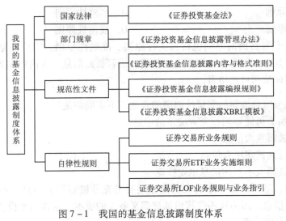

# 基金基础知识与法律法规 · 第20章 基金的信息披露

## 第1节 基金信息披露概述（16题）

**1.（单选题）** 违规承诺收益或者承担损失是基金信息披露的禁止行为之一，下列说法正确的是（　）。
Ⅰ投资者应根据自己的收益偏好和风险承受能力，审慎选择基金品种，即所谓的“买者自慎”
Ⅱ一般情况下，管理人可以受托管理基金资产，托管人可以受托保管基金资产
Ⅲ托管人可以替代投资者承担基金投资的盈亏
Ⅳ对于基金信息披露义务人而言，他没有承诺收益的能力
A.Ⅰ
B.Ⅰ、Ⅱ
C.Ⅰ、Ⅱ、Ⅲ
D.Ⅰ、Ⅱ、Ⅳ
**答案：** D
**解析：** 基金是存在一定投资风险的金融产品，投资者应根据自己的收益偏好和风险承受能力，审慎选择基金品种，即所谓“买者自慎”。一般情况下，管理人可以受托管理基金资产，托管人可以受托保管基金资产，但【没有人可以替代投资者承担基金投资的盈亏】（第Ⅲ项说法错误）。对于基金信息披露义务人而言，他没有承诺收益的能力。因此，如果基金信息披露中违规承诺收益或承担损失，则将被视为对投资者的诱骗及进行不当竞争。

**2.（单选题）** 虚假记载、误导性陈述或者重大遗漏是基金信息披露的禁止性行为之一，下列说法错误的是（　）。
Ⅰ虚假记载是指投资者对基金投资行为发生错误判断并产生重大影响的陈述
Ⅱ误导性陈述是指披露中存在应披露而未披露的信息
Ⅲ重大遗漏是指信息披露义务人将不存在的事实在基金信息披露文件中予以记载的行为
Ⅳ虚假记载、误导性陈述或者重大遗漏将扰乱市场正常秩序，侵害投资者合法权益
A.Ⅰ、Ⅱ、Ⅲ
B.Ⅰ、Ⅱ、Ⅳ
C.Ⅰ、Ⅲ、Ⅳ
D.Ⅱ、Ⅲ、Ⅳ
**答案：** A
**解析：** Ⅰ项说法错误，虚假记载是指信息披露义务人将不存在的事实在基金信息披露文件中予以记载的行为。
Ⅱ项说法错误，误导性陈述是指使投资者对基金投资行为发生错误判断并产生重大影响的陈述。
Ⅲ项说法错误，重大遗漏是指披露中存在应披露而未披露的信息，以至于影响投资者做出正确决策。

**3.（单选题）** 基金信息披露应用XBRL的意义在于（　）。
Ⅰ有助于基金管理人梳理内部信息系统和相关业务流程
Ⅱ基金信息服务中介可望以更低成本和以更便捷的方式获得高质量的公开信息
Ⅲ投资者将更容易获得有用的信息
Ⅳ监管部门可加大数据分析深度和广度
A.Ⅰ
B.Ⅰ、Ⅱ
C.Ⅰ、Ⅱ、Ⅲ
D.Ⅰ、Ⅱ、Ⅲ、Ⅳ
**答案：** D
**解析：** 总的来说，XBRL在基金信息披露中的应用将有利于促进信息披露的规范化、透明化和电子化，提高信息编报、传送和使用的效率与质量。具体而言，对于编制信息披露文件的基金管理人及进行财务信息复核的托管人，采用XBRL将有助于其梳理内部信息系统和相关业务流程，实现流程再造，促进业务效率和内部控制水平的全面提高；对于分析评价机构等基金信息服务中介，将可望以更低成本和更便捷的方式获得高质量的公开信息；对于投资者，将更容易获得有用的信息，便于其进行投资决策；对于监管部门，通过将公开信息和监管信息的XBRL化，可以增加数据分析深度和广度，提高监管效率和水平。

**4.（单选题）** 下列不属于基金信息披露禁止行为的是（　）。
A.承诺收益或承担损失
B.诋毁其他基金管理人
C.登载其他组织的祝贺性文字
D.对证券投资业绩进行公告
**答案：** D
**解析：** 为了防止信息误导给投资者造成损失，保护公众投资者的合法权益，维护证券市场的正常秩序，法律法规对于借公开披露基金信息为名编制、传播虚假基金信息，恶意进行信息误导，诋毁同行或竞争对手等行为做出了禁止性规定。具体包括以下情形：
(1).虚假记载、误导性陈述或者重大遗漏。
(2).对证券投资业绩进行预测。
(3).违规承诺收益或者承担损失。
(4).诋毁其他基金管理人、基金托管人或者基金销售机构。
(5).登载任何自然人、法人或者其他组织的祝贺性、恭维性或推荐性的文字。
(6).中国证监会禁止的其他行为。

**5.（单选题）** 我国基金信息披露的规范性文件中不包括（　）。
A.《证券投资基金信息披露内容和格式准则》
B.《证券投资基金信息披露编报规则》
C.《证券投资基金信息披露XBRL模板》
D.《证券交易所ETF业务实施细则》
**答案：** D
**解析：** 我国基金信息披露的规范性文件包括：《证券投资基金信息披露内容和格式准则》《证券投资基金信息披露编报规则》《证券投资基金信息披露XBRL模板》。
D项属于自律性规则。

**6.（单选题）** 以下有关基金信息披露作用的说法不正确的是（　）。
A.可以有效防止信息滥用
B.进行强制披露可消除逆向选择和道德风险等问题带来的低效无序状况，提高证券市场的效率
C.可以限制和防范基金管理不当和欺诈行为的发生
D.让投资者可以评价基金经理的管理水平，从而保证投资的正确
**答案：** D
**解析：** D项说法错误，基金信息披露有利于投资者的价值判断，但【不能】保证投资一定正确。

**7.（单选题）** 下列涉及基金信息披露的国家法律是（　）。
A.《证券投资基金法》
B.《证券投资基金信息披露编报规则》
C.《证券交易所业务规则》
D.《证券交易所LOF业务规则与业务指引》
**答案：** A
**解析：** A项属于国家法律，B项属于规范性文件，CD项属于自律性规则。

**8.（单选题）** 以下属于基金信息披露的自律规则的是（　）。
A.《证券投资基金法》
B.《证券交易所业务规则》
C.《证券投资基金信息披露管理办法》
D.《证券投资基金信息披露内容与格式准则》
**答案：** B
**解析：** A项属于基金信息披露的国家法律；C项属于基金信息披露的部门规章；D项属于基金信息披露的规范性文件。

**9.（单选题）** 下列属于基金定期报告的是（　）。
A.基金年度报告
B.基金合同
C.基金招募说明书
D.基金托管协议
**答案：** A
**解析：** 基金定期报告，包括【基金年度报告、基金半年度报告和基金季度报告】。

**10.（单选题）** 基金信息披露的禁止行为包括（　）。
Ⅰ虚假记载、误导性陈述或者重大遗漏
Ⅱ对证券投资业绩进行预测
Ⅲ承诺收益或者承担损失
Ⅳ诋毁其他基金管理人、基金托管人或者基金销售机构
A.Ⅰ、Ⅱ、Ⅲ
B.Ⅱ、Ⅲ、Ⅳ
C.Ⅰ、Ⅳ
D.Ⅰ、Ⅱ、Ⅲ、Ⅳ
**答案：** D
**解析：** 基金信息披露的禁止行为包括：
（1）虚假记载、误导性陈述或者重大遗漏。
（2）对证券投资业绩进行预测。
（3）违规承诺收益或者承担损失。
（4）诋毁其他基金管理人、基金托管人或者基金销售机构。
（5）登载任何自然人、法人或者其他组织的祝贺性、恭维性或推荐性的文字。
（6）中国证监会禁止的其他行为。

**11.（单选题）** 下列不属于我国基金信息披露制度体系的是（　）。
A.基金信息披露的地方政策
B.基金信息披露的国家法律
C.基金信息披露的规范性文件
D.信息披露自律性规则
**答案：** A
**解析：** 我国的基金信息披露制度体系可分为【国家法律、部门规章、规范性文件与自律性规则】四个层次。

**12.（单选题）** 在我国，上市公司自（　）年底开始尝试应用XBRL报送定期报告。
A.2001年
B.2002年
C.2003年
D.2004年
**答案：** C
**解析：** 在我国，上市公司自【2003年】年底开始尝试应用XBRL报送定期报告。

**13.（单选题）** 相对于（　）审查制度，强制性信息披露的基本推论是投资者在公开信息的基础上“买者自慎”。
A.真实性
B.实质性
C.准确性
D.完整性
**答案：** B
**解析：** 相对于【实质性】审查制度，强制性信息披露的基本推论是投资者在公开信息的基础上“买者自慎”。

**14.（单选题）** 资本市场的基础是（　）。
A.充足的资金
B.信息披露
C.资金增值
D.高效的交易平台
**答案：** B
**解析：** 资本市场的基础是【信息披露】，监管的主要内容之一就是对信息披露的监管。

**15.（单选题）** 当基金发生重大事件可能对投资者决策产生重大影响时，基金管理人应在重大事件发生之日起2日内披露临时报告，体现了基金信息披露的（　）。
A.真实性原则
B.准确性原则
C.完整性原则
D.及时性原则
**答案：** D
**解析：** 【及时性原则】要求以最快的速度公开信息，体现在基金管理人应在法定期限内披露基金招募说明书、定期报告等文件，在重大事件发生之日起2日内披露临时报告。

**16.（单选题）** 要求将信息向市场上所有投资者披露，而不是仅向个别机构或投资者披露，体现的是基金信息披露的（　）。
A.规范性原则
B.易得性原则
C.公平性原则
D.完整性原则
**答案：** C
**解析：** 【公平性原则】要求将信息向市场上所有的投资者平等公开地披露，而不是仅向个别机构或投资者披露。

## 第2节 基金主要当事人的信息披露义务（10题）

**1.（单选题）** 开放式基金合同生效后每（　）更新招募说明书。
A.3个月
B.6个月
C.1年
D.9个月
**答案：** B
**解析：** 开放式基金合同生效后每6个月结束之日起45日内，将更新的招募说明书登载在管理人网站上，更新的招募说明书摘要登载在指定报刊上。

**2.（单选题）** 基金管理人应当在每季结束后（　）个工作日内编制完成季度报告并对外披露。
A.15
B.20
C.10
D.30
**答案：** A
**解析：** 在每年结束后90日内，在指定报刊上披露年度报告摘要，在管理人网站上披露年度报告全文。在上半年结束后60日内，在指定报刊上披露半年度报告摘要，在管理人网站上披露半年度报告全文。在每季结束后15个工作日内，在指定报刊和管理人网站上披露基金季度报告。

**3.（单选题）** （　）中的财务报告需要会计师事务所进行审计。
A.基金季度报告
B.基金月度报告
C.基金年度报告
D.基金临时报告
**答案：** C
**解析：** 公开披露的基金信息需要由中介机构出具意见书。例如，会计师事务所需要对基金年度报告中的财务报告、基金清算报告等进行审计，律师事务所需要对基金招募说明书、基金清算报告等文件出具法律意见书。

**4.（单选题）** 基金份额持有人自行召集持有人大会时，应至少提前（　）日公告持有人大会的召开时间、会议形式、审议事项、议事程序和表决方式等事项。
A.45
B.30
C.10
D.15
**答案：** B
**解析：** 根据《证券投资基金法》，当代表基金份额10%以上的基金份额持有人就同一事项要求召开持有人大会，而基金份额持有人大会的日常机构、基金管理人和托管人都不召集的时候，代表基金份额10%以上的持有人有权自行召集。并报中国证监会备案。此时，该类持有人应至少提前30日公告持有人大会的召开时间、会议形式、审议事项、议事程序和表决方式等事项。

**5.（单选题）** 在基金份额发售的（　），基金托管人应将基金合同、托管协议登载在托管人网站上。
A.当月
B.当日
C.3日前
D.3日后
**答案：** C
**解析：** 基金托管人在基金份额发售的3日前，将基金合同、托管协议登载在托管人网站上。

**6.（单选题）** 基金管理人的信息披露事项不涉及（　）环节。
A.基金上市交易
B.基金募集
C.基金投资运作
D.总值披露
**答案：** D
**解析：** 对于基金管理人来说，主要负责办理与基金财产管理业务活动有关的信息披露事项，具体涉及基金募集、上市交易、投资运作、净值披露等各环节。

**7.（单选题）** 基金托管人披露的信息不涉及（　）。
A.代理清算交割
B.会计核算
C.总值复核
D.投资运作监督
**答案：** C
**解析：** 基金托管人的信息披露义务主要是办理与基金托管业务活动有关的信息披露事项，具体涉及基金资产保管、代理清算交割、会计核算、净值复核、投资运作监督等环节。

**8.（单选题）** 基金托管人召集基金份额持有人大会应至少提前（　）日公告大会的召开时间、会议形式、审议事项、议事程序和表决方式等事项。
A.30
B.45
C.15
D.10
**答案：** A
**解析：** 基金托管人召集基金份额持有人大会的，应至少提前30日公告大会的召开时间、会议形式、审议事项、议事程序和表决方式等事项。会议召开后，应将持有人大会决定的事项报中国证监会核准或备案，并予公告。

**9.（单选题）** 基金管理人召集基金份额持有人大会，应至少提前30日公告大会的事项不包括（　）。
A.基金份额持有人名录
B.召开时间
C.表决方式
D.审议事项
**答案：** A
**解析：** 基金管理人召集基金份额持有人大会的，应至少提前30日公告大会的召开时间、会议形式、审议事项、议事程序和表决方式等事项。

**10.（单选题）** 开放式基金的开放期，基金管理人应披露基金每个开放日的（　）。
A.基金资产净值和基金累计份额净值
B.基金资产净值和基金份额净值
C.基金资产总值和基金资产净值
D.基金份额净值和基金份额累计净值
**答案：** D
**解析：** 开放式基金在开始办理申购或者赎回前，至少每周公告一次资产净值和份额净值；开放申购赎回后，应于每个开放日的次日披露基金份额净值和份额累计净值。如遇半年末或年末，还应披露半年度和年度最后一个市场交易日的基金资产净值、份额净值和份额累计净值。

## 第3节 基金募集信息披露（10题）

**1.（单选题）** 下列不属于招募说明书包含的重要信息的是（　）。
A.基金运作方式
B.基金收益分配原则和执行方式
C.基金份额的发售、交易、申购、赎回的约定
D.从基金资产中列支的费用的种类、计提标准和方式
**答案：** B
**解析：** 招募说明书包含的重要信息有：(1)基金运作方式；(2)从基金资产中列支的费用的种类、计提标准和方式；(3)基金份额的发售、交易、申购、赎回的约定，特别是买卖基金费用的相关条款；(4)基金投资目标、投资范围、投资策略、业绩比较基准、风险收益特征、投资限制等；(5)基金资产净值的计算方法和公告方式；(6)基金风险提示；(7)招募说明书摘要。B项基金收益分配原则和执行方式属于基金合同的主要披露事项。

**2.（单选题）** 下列关于基金合同特定约定的事项说法中，正确的是（　）。
Ⅰ.持有人大会是基金份额持有人维权的一种方式
Ⅱ.基金合同当事人应当在基金合同中明确约定持有人大会的召开、议事规则等事项
Ⅲ.基金合同一旦终止，基金财产就进入清算程序，对于清算后的基金财产，投资者享有分配权
Ⅳ.基金投资者需要事先了解，以便对基金产品的存续期限有所预期
A.Ⅰ、Ⅱ、Ⅲ
B.Ⅰ、Ⅱ、Ⅳ
C.Ⅰ、Ⅲ、Ⅳ
D.Ⅰ、Ⅱ、Ⅲ、Ⅳ
**答案：** D
**解析：** 基金合同特别约定的事项包括基金各当事人的权利和义务、基金持有人大会、基金合同终止等方面的信息。
(1)基金当事人的权利和义务，特别是基金份额持有人的权利。例如，基金份额持有人可申请赎回持有的基金份额，参与分配清算后的剩余基金财产，要求召开基金份额持有人大会并对大会审议事项行使表决权，对基金管理人、托管人或基金份额发售机构损害其合法权益的行为依法提起行政诉讼等。
(2)基金持有人大会的召集、议事及表决的程序和规则。根据《证券投资基金法》，提前终止基金合同、转换基金运作方式、提高管理人或托管人的报酬标准、更换管理人或托管人等事项均需要通过基金份额持有人大会审议通过。持有人大会是基金份额持有人维权的一种方式，基金合同当事人应当在基金合同中明确约定持有人大会的召开、议事规则等事项。
(3)基金合同终止的事由、程序及基金财产的清算方式。基金合同一旦终止，基金财产就进入清算程序，对于清算后的基金财产，投资者享有分配权。对此，基金投资者需要事先了解，以便对基金产品的存续期限有所预期。

**3.（单选题）** 下列属于招募说明书的主要披露事项的是（　）。
Ⅰ.基金募集申请的核准文件名称和核准日期
Ⅱ.基金份额的发售日期、价格、费用和期限
Ⅲ.基金份额的发售方式、发售机构及登记机构名称
Ⅳ.基金资产的估值
A.Ⅰ
B.Ⅰ、Ⅱ
C.Ⅰ、Ⅱ、Ⅲ
D.Ⅰ、Ⅱ、Ⅲ、Ⅳ
**答案：** D
**解析：** 招募说明书的主要披露事项包括：
(1)招募说明书摘要。
(2)基金募集申请的核准文件名称和核准日期。
(3)基金管理人、基金托管人的基本情况。
(4)基金份额的发售日期、价格、费用和期限。
(5)基金份额的发售方式、发售机构及登记机构名称。
(6)基金份额申购、赎回的场所、时间、程序、数额与价格，拒绝或暂停接受申购、暂停赎回或延缓支付、巨额赎回的安排等。
(7)基金的投资目标、投资方向、投资策略、业绩比较基准、投资限制。
(8)基金资产的估值。
(9)基金管理人和基金托管人的报酬及其他基金运作费用的费率水平、收取方式。
(10)基金认购费、申购费、赎回费、转换费的费率水平、计算公式、收取方式。
(11)出具法律意见书的律师事务所和审计基金财产的会计师事务所的名称和住所。
(12)风险警示内容。
(13)基金合同和基金托管协议的内容摘要。

**4.（单选题）** 投资者交纳基金份额认购款项时，即表明其对（　）的承认和接受，此时基金合同成立。
A.基金托管协议
B.基金合同
C.基金招募说明书
D.基金临时公告
**答案：** B
**解析：** 投资者交纳基金份额认购款项时，即表明其对基金合同的承认和接受，此时基金合同成立。

**5.（单选题）** 下列说法中，错误的是（　）。
A.不同类别基金的管理费和托管费水平存在差异
B.不同开放式基金的申购、赎回费率可能不同
C.封闭式基金主要通过交易所进行交易
D.封闭式基金主要在基金的直销和代销网点申购和赎回
**答案：** D
**解析：** 封闭式基金主要通过交易所进行交易；开放式基金主要在基金的直销和代销网点申购和赎回。故D项说法错误

**6.（单选题）** 投资者只需阅读招募说明书摘要信息，就可以了解到近（　）来与基金募集相关的最新信息。
A.3个月
B.6个月
C.12个月
D.24个月
**答案：** B
**解析：** 在基金存续期的募集过程中，投资者只需阅读招募说明书摘要信息，即可了解基金产品的基本特征、过往投资业绩、费用情况以及近6个月来与基金募集相关的最新信息。

**7.（单选题）** 基金合同是约定基金管理人、（　）和基金份额持有人权利义务关系的重要法律文件。
A.基金公司
B.基金托管人
C.商业银行
D.证券公司
**答案：** B
**解析：** 基金合同是约定基金管理人、基金托管人和基金份额持有人权利义务关系的重要法律文件。

**8.（单选题）** 下列关于基金招募说明书的说法，不正确的是（　）。
A.是约定基金管理人、基金托管人和基金份额持有人权利义务关系的重要法律文件
B.是基金管理人为发售基金份额而依法制作的
C.是指导投资者认购基金份额的规范性文件
D.将所有对投资者做出投资判断有重大影响的信息予以充分披露
**答案：** A
**解析：** A项错误，基金合同是约定基金管理人、基金托管人和基金份额持有人权利义务关系的重要法律文件。

**9.（单选题）** 基金合同特别约定的事项不包括（　）。
A.基金运作方式
B.基金当事人的权利和义务
C.基金持有人大会的召集、议事及表决的程序和规则
D.基金合同终止的事由、程序及基金财产的清算方式
**答案：** A
**解析：** 基金合同特别约定的事项包括：基金当事人的权利和义务，特别是基金份额持有人的权利；基金持有人大会的召集、议事及表决的程序和规则；基金合同终止的事由、程序及基金财产的清算方式。

**10.（单选题）** 基金招募说明书中最为重要的信息不包括（　）。
A.基金投资目标
B.基金投资范围
C.业绩比较基准
D.基金费用计提标准
**答案：** D
**解析：** 基金投资目标、投资范围、投资策略、业绩比较基准、风险收益特征、投资限制等，这是招募说明书中最为重要的信息，因为它体现了基金产品的风险收益水平，可以帮助投资者选择与自己风险承受能力和收益预期相符合的产品。

## 第4节 基金运作信息披露（24题）

**1.（单选题）** 下列选项不属于普通基金净值公告内容的是（　）。
A.基金份额累计净值
B.基金最近7日年化收益率
C.基金份额净值
D.基金资产净值
**答案：** B
**解析：** 普通基金净值公告主要包括基金资产净值、份额净值和份额累计净值等信息。

**2.（单选题）** 年度报告应提供最近（　）个会计年度的主要会计数据和财务指标。
A.1
B.2
C.3
D.4
**答案：** C
**解析：** 半年度报告只需披露当期的主要会计数据和财务指标，而年度报告应提供最近3个会计年度的主要会计数据和财务指标。

**3.（单选题）** 在半年度报告和年度报告的重大事件揭示中，基金管理人将披露报告期内偏离度的绝对值达到或超过（　）的信息。
A.0.005
B.0.008
C.0.003
D.0.001
**答案：** A
**解析：** 在半年度报告和年度报告的重大事件揭示中，基金管理人将披露报告期内偏离度的绝对值达到或超过0.5％的信息。

**4.（单选题）** 按照披露时间的不同，货币市场基金收益公告不包括（　）。
A.年度收益公告
B.封闭期的收益公告
C.开放日的收益公告
D.节假日的收益公告
**答案：** A
**解析：** 按照披露时间的不同，货币市场基金收益公告包括封闭期的收益公告、开放日的收益公告和节假日的收益公告。

**5.（单选题）** 为明确信息披露义务人的责任，提醒投资者注意投资风险，目前法规规定应在基金年度报告的扉页做出的提示不包括（　）。
A.投资风险提示
B.托管人管理和运用基金资产的原则
C.年度报告中注册会计师出具非标准无保留意见的提示
D.管理人和托管人的披露责任
**答案：** B
**解析：** 为明确信息披露义务人的责任，提醒投资者注意投资风险，目前法规规定应在基金年度报告的扉页就以下方面做出提示：
（1）管理人和托管人的披露责任。
（2）管理人管理和运用基金资产的原则。
（3）投资风险提示。
（4）年度报告中注册会计师出具非标准无保留意见的提示。

**6.（单选题）** 基金年度报告披露的持有人信息之一为上市基金前（　）名持有人的名称、持有份额及占总份额的比例。
A.10
B.20
C.5
D.3
**答案：** A
**解析：** 基金年度报告披露的持有人信息之一为上市基金前10名持有人的名称、持有份额及占总份额的比例。

**7.（单选题）** 可能对基金份额持有人权益或者基金份额的价格产生重大影响的事项不包括（　）。
A.基金份额持有人大会的召开
B.更换基金管理人或托管人
C.开放式基金发生巨额赎回且按期支付赎回款项
D.延长基金合同期限
**答案：** C
**解析：** 如果预期某种信息可能对基金份额持有人权益或者基金份额的价格产生重大影响，则该信息为重大信息，相关事件为重大事件。基金的重大事件可包括：基金份额持有人大会的召开，提前终止基金合同，延长基金合同期限，转换基金运作方式，更换基金管理人或托管人，基金管理人的董事长、总经理及其他高级管理人员、基金经理和基金托管人的基金托管部门负责人发生变动，涉及基金管理人、基金财产、基金托管业务的诉讼，基金份额净值计价错误金额达基金份额净值的0.5%，开放式基金发生巨额赎回并延期支付，等等。

**8.（单选题）** 下列关于基金半年度报告财务报表附注披露的内容，说法错误的是（　）。
A.半年度财务报表附注重点披露比上年度财务会计报告更新的信息，并遵循重要性原则进行披露
B.半年度报告不需要披露所有的关联关系，只披露关联关系的变化情况，关联交易的披露期限也不同于年度报告
C.半年度报告只对当期的报表项目进行说明，不需要说明两个年度的报表项目
D.半年度报告要对人事变动的状况做出说明
**答案：** D
**解析：** D项说法错误，半年度报告不需要对人事变动的状况做出说明。
半年度报告的披露有以下特点：
(1)半年度报告不要求进行审计。
(2)半年度报告只需披露当期的主要会计数据和财务指标，而年度报告应提供最近3个会计年度的主要会计数据和财务指标。
(3)半年度报告披露净值增长率列表的时间段与年度报告有所不同。半年度报告需要披露过去1个月的净值增长率，但无须披露过去5年的净值增长率。
(4)半年度报告无须披露近3年每年的基金收益分配情况。
(5)半年度报告的管理人报告无须披露内部监察报告。
(6)财务报表附注的披露。半年度财务报表附注重点披露比上年度财务会计报告更新的信息，并遵循重要性原则进行披露。（A项说法正确）例如：①半年度报告无须披露所有的关联关系，只披露关联关系的变化情况，而且关联交易的披露期限也不同于年度报告。（B项说法正确）②半年度报告只对当期的报表项目进行说明，无须说明2个年度的报表项目。（C项说法正确）
(7)重大事件揭示中，半年度报告只报告期内改聘会计师事务所的情况，无须披露支付给聘任会计师事务所的报酬及事务所已提供审计服务的年限等。
(8)半年度报告摘要的财务报表附注无须对重要的报表项目进行说明；而年度报告摘要的报表附注在说明报表项目部分时，则因审计意见的不同而有所差别。

**9.（单选题）** 基金上市交易公告书的主要披露事项不包括（　）。
A.基金财务状况
B.开放式基金份额变动
C.持有人户数
D.基金投资组合报告
**答案：** B
**解析：** 基金上市交易公告书的主要披露事项包括：基金概况、基金募集情况与上市交易安排、持有人户数、持有人结构及前10名持有人、主要当事人介绍、基金合同摘要、基金财务状况、基金投资组合报告、重大事件揭示等。

**10.（单选题）** 以下选项中不属于基金运作信息披露文件的是（　）。
A.基金上市交易公告书
B.基金资产净值和份额净值公告
C.基金定期公告
D.基金份额发售公告
**答案：** D
**解析：** 基金运作信息披露文件主要包括基金净值公告、基金定期公告以及基金上市交易公告书等。其中，基金资产净值和份额净值公告属于“基金净值公告”。D项基金份额发售公告属于基金募集信息披露。

**11.（单选题）** 基金合同生效不足（　）的，基金管理人可以不编制当期季度报告、半年度报告或年度报告。
A.1个月
B.2个月
C.3个月
D.6个月
**答案：** B
**解析：** 基金合同生效不足2个月的，基金管理人可以不编制当期季度报告、半年度报告或年度报告。

**12.（单选题）** 基金的重大事件不包括（　）。
A.基金份额净值计价错误金额达基金份额净值的0.1%
B.延长基金合同期限
C.转换基金运作方式
D.更换基金管理人的董事长、总经理等高级管理人员
**答案：** A
**解析：** 基金的重大事件可包括：基金份额持有人大会的召开，提前终止基金合同，延长基金合同期限，转换基金运作方式，更换基金管理人或托管人，基金管理人的董事长、总经理及其他高级管理人员、基金经理和基金托管人的基金托管部门负责人发生变动，涉及基金管理人、基金财产、基金托管业务的诉讼，基金份额净值计价错误金额达基金份额净值的0.5%，开放式基金发生巨额赎回并延期支付，等等。

**13.（单选题）** 基金年度报告是基金存续期信息披露中信息量最大的文件，应当在每年结束之日起（　）日内予以公告。
A.10
B.30
C.60
D.90
**答案：** D
**解析：** 基金年度报告是基金存续期信息披露中信息量最大的文件。应当在每年结束之日起90日内，编制完成基金年度报告，并将年度报告正文登载于网站上，将年度报告摘要登载在指定报刊上。

**14.（单选题）** 下列属于基金临时信息披露的“重大性”概念标准是（　）。
A.影响基金托管人决策
B.影响投资者决策标准和影响证券市场价格标准
C.对基金管理费、托管费产生重大影响
D.影响基金管理人决策
**答案：** B
**解析：** 关于基金信息披露的重大性标准：各国(地区)信息披露所采用的“重大性”概念有以下两种标准：一种是“影响投资者决策标准”，另一种是“影响证券市场价格标准”。

**15.（单选题）** 下列报告中，必须每季度定期公布的是（　）。
A.基金投资组合报告
B.基金公开说明书
C.内部监察报告
D.基金净值公告
**答案：** A
**解析：** 基金季度报告主要包括基金概况、主要财务指标和净值表现、管理人报告、投资组合报告、开放式基金份额变动等内容。

**16.（单选题）** 基金年度报告中应披露的财务指标不包括（　）。
A.加权平均份额上期利润
B.期末基金份额净值
C.加权平均净值利润率
D.本期份额净值增长率
**答案：** A
**解析：** 基金年度报告中应披露以下财务指标：本期利润、本期利润扣减本期公允价值变动损益后的净额、加权平均份额本期利润、期末可供分配利润、期末可供分配份额利润、期末资产净值、期末基金份额净值、加权平均净值利润率、本期份额净值增长率和份额累计净值增长率等。

**17.（单选题）** 下列关于基金年度报告和半年度报告的说法中，错误的是（　）。
A.基金半年度报告需要披露所有的关联关系
B.基金的半年度报告不要求进行审计
C.基金年度报告的财务会计报告必须经过审计
D.基金半年度报告摘要的财务报表附注无须对重要的报表项目进行说明
**答案：** A
**解析：** A项说法错误，基金半年度报告无须披露所有的关联关系，只披露关联关系的变化情况，而且关联交易的披露期限也不同于年度报告。

**18.（单选题）** 为了进一步保障基金信息质量，法规规定基金年度报告应经（　）以上独立董事签字同意，并由董事长签发。
A.1/3
B.1/2
C.2/3
D.3/5
**答案：** C
**解析：** 为了进一步保障基金信息质量，法规规定基金年度报告应经2/3以上独立董事签字同意，并由董事长签发。

**19.（单选题）** 投资者通过将基金（　）与同期基金业绩比较基准收益率进行比较，可以了解基金实际运作与基金合同规定基准的差异程度，判断基金的实际投资风格。
A.净值增长指标
B.本期利润
C.加权平均份额本期利润
D.加权平均净值利润率
**答案：** A
**解析：** 投资者通过将基金净值增长指标与同期基金业绩比较基准收益率进行比较，可以了解基金实际运作与基金合同规定基准的差异程度，判断基金的实际投资风格。

**20.（单选题）** 各国(地区)信息披露所采用的“重大性”的界定标准是（　）。
Ⅰ.影响投资者决策标准
Ⅱ.影响证券市场价格标准
Ⅲ.影响波及范围标准
A.Ⅰ、Ⅲ
B.Ⅰ、Ⅱ
C.Ⅰ、Ⅱ、Ⅲ
D.Ⅱ、Ⅲ
**答案：** B
**解析：** 各国(地区)信息披露所采用的“重大性”概念有以下两种标准：一种是“影响投资者决策标准”，另一种是“影响证券市场价格标准”。

**21.（单选题）** 以下不在基金财务报表附注中披露的内容是（　）。
A.重要会计政策
B.资产负债表日后非调整事项的说明
C.投资组合重大变动
D.关联方关系及其交易
**答案：** C
**解析：** 基金财务报表附注的披露内容主要包括：基金基本情况，会计报表的编制基础，遵循会计准则及其他有关规定的声明，重要会计政策和会计估计，会计政策和会计估计变更以及差错更正的说明，税项，或有和承诺事项，资产负债表日后非调整事项的说明，关联方关系及其交易，重要报表项目的说明，利润分配情况，期末基金持有的流通受限证券，金融工具风险及管理等。

**22.（单选题）** 报告期内累计买入、累计卖出价值超出期初基金资产净值（　）时，基金管理人需要在基金股票投资组合重大变动事项中披露股票明细。
A.1%
B.2%
C.3%
D.5%
**答案：** B
**解析：** 基金股票投资组合重大变动的披露内容包括：报告期内累计买入、累计卖出价值超出期初基金资产净值2%（报告期内基金合同生效的基金，采用期末基金资产净值的2%）的股票明细；对累计买入、累计卖出价值前20名的股票价值低于2%的，应披露至少前20名的股票明细；整个报告期内买入股票的成本总额及卖出股票的收入总额。

**23.（单选题）** 关于基金年度报告披露的持有人信息，说法错误的是（　）。
A.上市基金前20名持有人的名称、持有份额及占总份额的比例
B.持有人结构，包括机构投资者、个人投资者持有的基金份额及占总份额的比例
C.持有人户数，户均持有基金份额
D.上市基金前10名持有人的名称、持有份额及占总份额的比例
**答案：** A
**解析：** 基金年度报告披露的持有人信息主要有：
（1）上市基金前10名持有人的名称、持有份额及占总份额的比例。
（2）持有人结构，包括机构投资者、个人投资者持有的基金份额及占总份额的比例。
（3）持有人户数及户均持有基金份额。

**24.（单选题）** 我国基金年度报告的主要内容不包括（　）。
A.基金交易的业务规则的编制及披露
B.基金财务会计报告的编制与披露
C.关于年度报告中的重要提示
D.基金投资组合报告的披露
**答案：** A
**解析：** 基金年度报告的主要内容有：基金管理人和托管人在年度报告披露中的责任、正文与摘要的披露、关于年度报告中的重要提示、基金财务指标的披露、基金净值表现的披露、基金管理人报告的披露、基金财务会计报告的编制与披露、基金投资组合报告的披露、基金持有人信息的披露、开放式基金份额变动的披露。

## 第5节 特殊基金品种的信息披露（7题）

**1.（单选题）** QDII基金在基金合同中应披露的信息不包括（　）。
A.投资金融衍生品的信息
B.境外市场政府管制风险
C.期末在各个国家、地区证券市场的股票投资分布情况
D.披露基金与境外基金之间的费率安排
**答案：** C
**解析：** QDII基金的基金合同、招募说明书中的特殊披露要求：
(1)境外投资顾问和境外托管人信息。
(2)投资交易信息。如QDII基金投资金融衍生品，应在基金合同、招募说明书中详细说明拟投资的衍生品种及其基本特性，拟采取的组合避险、有效管理策略及采取的方式、频率。如QDII基金投资境外基金，应披露基金与境外基金之间的费率安排。
(3)投资境外市场可能产生的风险信息，包括境外市场风险、政府管制风险、政治风险、流动性风险、信用风险等的定义、特征及可能发生的后果。

**2.（单选题）** 对QDII基金来说，在其开放申购、赎回前，资产净值和份额净值的披露频率是（　）。
A.每交易日披露1次
B.至少每周披露1次
C.至少每周披露2次
D.至少每月披露2次
**答案：** B
**解析：** QDII基金也是开放式基金，在其开放申购、赎回前，一般至少每周披露一次资产净值和份额净值；开放申购、赎回后，则需要披露每个开放日的份额净值和份额累计净值。QDII基金的净值在估值日后1～2个工作日内披露。

**3.（单选题）** ETF上市交易之后，需按交易所的要求，在每日开市前披露当日的申购、赎回清单，并在交易时间内即时揭示（　）。
A.申购、赎回清单
B.基金份额净值
C.基金份额参考净值
D.基金净资产
**答案：** C
**解析：** ETF上市交易之后，需按交易所的要求，在每日开市前披露当日的申购、赎回清单，并在交易时间内即时揭示基金份额参考净值。

**4.（单选题）** 在每日开市前，基金管理人需向（　）提供ETF的申购清单和赎回清单。
Ⅰ.证券交易所
Ⅱ.证券登记结算机构
Ⅲ.基金托管人
A.Ⅰ、Ⅱ、Ⅲ
B.Ⅱ、Ⅲ
C.Ⅰ、Ⅲ
D.Ⅰ、Ⅱ
**答案：** D
**解析：** 在每日开市前，基金管理人需向证券交易所、证券登记结算机构提供ETF的申购、赎回清单。

**5.（单选题）** QDII基金在披露相关信息时，下列说法不正确的是（　）。
A.可同时采用中、英文，并以英文为准
B.可单独或同时以人民币、美元等主要外汇币种计算并披露净值信息
C.当涉及币种之间转换的，应披露汇率数据来源，并保持一致性
D.QDII基金在其开放申购、赎回前，应至少每周披露1次资产净值和份额净值
**答案：** A
**解析：** A项说法错误，QDII基金在披露相关信息时，可同时采用中文和英文，并以中文为准。

**6.（单选题）** 不属于ETF基金合同和招募说明书中，需明确说明的有（　）。
A.认购方式
B.赎回方式
C.期限
D.赎回基金份额涉及的对价种类
**答案：** C
**解析：** 在ETF基金合同和招募说明书中，需明确基金份额的各种认购、申购、赎回方式，以及投资者认购、申购、赎回基金份额涉及的对价种类等。

**7.（单选题）** 基金上市后，ETF基金份额参考净值的实时计算与公布是由（　）负责。
A.基金托管人
B.基金管理人
C.登记结算机构
D.证券交易所
**答案：** D
**解析：** 在交易时间内，证券交易所根据基金管理人提供的ETF基金份额参考净值计算方式、申购和赎回清单中的组合证券等信息，实时计算并公布基金份额参考净值。
