# 证券投资基金基础知识 · 第4章 权益投资

## 第1节 资本结构（8题）

**1.（单选题）** 下列关于债务资本与权益资本说法错误的是（　）。
A.债务资本是通过借债方式筹集的资本
B.权益资本是通过发行股票或置换所有权筹集的资本
C.债务资本在正常经营情况下不会偿还给投资人
D.两种最主要的权益证券是普通股和优先股
**答案：** C
**解析：** 债务资本需要在规定期限内还本付息，并非在正常经营情况下不会偿还给投资人，C 选项说法错误；A 选项对债务资本筹集方式表述正确，B 选项对权益资本筹集方式表述正确，D 选项对主要权益证券表述正确。答案：C

**2.（单选题）** 随着企业债务增加而提高的经营风险和可能产生的破产成本，会增加企业的额外成本，而最佳的资本结构应当是负债和所有者之间的一个均衡点，这一均衡点被称为（　）。
A.最佳收益比率
B.最佳负债比率
C.最佳权益比率
D.最佳股本比率
**答案：** B
**解析：** 题干描述的是随着企业债务变化带来经营风险和破产成本等额外成本，要找负债和所有者之间的均衡点，这个均衡点是关于负债的比例，即最佳负债比率。答案：B

**3.（单选题）** 在公司解散或破产清算时，以下清偿顺序正确的是（　）。
A.债权人、优先股、普通股
B.优先股、债权人、普通股
C.优先股、普通股、债权人
D.债权人、普通股、优先股
**答案：** A
**解析：** 公司解散或破产清算时，债权人具有优先求偿权，会先获得清偿；优先股在剩余资产分配上优先于普通股。所以顺序是债权人先于优先股，优先股先于普通股。答案：A

**4.（单选题）** 以下关于债务资本说法正确的是（　）
A.通过借债方式筹集的资本
B.不偿还本金
C.通过置换所有权筹集资金
D.代表所有权
**答案：** A
**解析：** 债务资本是企业通过借债方式筹集的资本，需要偿还本金，它体现的是债权债务关系，并非置换所有权或代表所有权。答案：A

**5.（单选题）** 公司资产在不同证券持有者中享有不同的清偿顺序，享有公司资产的最高索取权的是（　）。
A.优先股股东
B.普通股股东
C.债券持有者
D.实际控股人
**答案：** C
**解析：** 公司破产清算时，债券持有者作为公司的债权人，对公司资产的索取权优先于股东。优先股股东和普通股股东都属于股东，在债券持有者之后受偿。实际控股人如果是以股东身份，也在债券持有者之后。所以享有公司资产最高索取权的是债券持有者。答案：C

**6.（单选题）** 公司向债权人借入资金的利息高低与（　）有关。
A.公司的经营风险
B.债权人的经营风险
C.公司的规模
D.公司的利润率
**答案：** A
**解析：** 公司经营风险越大，债权人面临风险越高，要求的利息回报就越高；经营风险小，债权人要求利息回报相对低。公司规模、利润率与利息高低没有直接关联，债权人经营风险与公司向其借款利息高低无关。答案：A

**7.（单选题）** 优先股票的“优先”主要体现在（　）。
A.对企业经营参与权的优先
B.认购新发行股票的优先
C.公司盈利很多时，其股息高于普通股股利
D.股息分配和剩余资产清偿的优先
**答案：** D
**解析：** 优先股票的“优先”体现在股息分配优先和剩余资产清偿优先。普通股股东有对企业经营参与权、认购新发行股票的优先，且优先股票股息相对固定，并非公司盈利多就股息高于普通股。答案：D

**8.（单选题）** 下列关于优先股与普通股说法错误的是（　）。
A.代表对公司的所有权
B.收益不固定
C.正常经营情况下不会偿还给投资人
D.同属于权益资本
**答案：** B
**解析：** 普通股收益不固定，其股利分配取决于公司盈利情况等多种因素。而优先股通常有固定的股息率，收益相对固定。选项A，优先股和普通股都代表对公司的所有权；选项C，公司正常经营情况下，权益资本一般不会偿还给投资人；选项D，优先股与普通股都属于权益资本。答案：B

## 第2节 权益类证券（23题）

**1.（单选题）** 有担保的美国存托凭证(ADRs)可分为（　）。
Ⅰ一级公募ADRs
Ⅱ二级公募ADRs
Ⅲ三级公募ADRs
Ⅳ144A规则下的私募ADRs
A.Ⅰ、Ⅱ、Ⅲ、Ⅳ
B.Ⅰ、Ⅱ
C.Ⅰ、Ⅱ、Ⅲ
D.Ⅲ、Ⅳ
**答案：** A
**解析：** 有担保的美国存托凭证分为一、二、三级公募ADRs和144A规则下的私募ADRs这四种类型。答案：A

**2.（单选题）** 以下不属于再融资的方式是（　）。
A.股票回购
B.发行可转换债券
C.非公开发行股票
D.向不特定对象公开募集
**答案：** A
**解析：** 再融资是指上市公司通过配股、增发和发行可转换债券等方式在证券市场上进行的直接融资。非公开发行股票即定向增发，向不特定对象公开募集即增发，发行可转换债券都属于再融资方式。而股票回购是上市公司利用现金等方式从股票市场上购回本公司发行在外一定数额股票的行为，不属于再融资。答案：A

**3.（单选题）** （　）是指在一段时期内，持有者有权按照约定的转换价格或转换比率将其转换成普通股股票的公司债券。
A.可转换债券
B.权证
C.企业债券
D.普通股票
**答案：** A
**解析：** 题目描述的是一种能按约定转换为普通股股票的公司债券，这正是可转换债券的定义。答案：A

**4.（单选题）** 下列不属于可转换债券的基本要素的是（　）。
A.赎回条款
B.转换期限
C.市场利率
D.回售条款
**答案：** C
**解析：** 可转换债券基本要素包括标的股票、票面利率、转换期限、转换价格、转换比例、赎回条款、回售条款等，市场利率不属于其基本要素。答案：C

**5.（单选题）** （）是指股票所载有权利的有效性是始终不变的。
A.收益性
B.参与性
C.风险性
D.永久性
**答案：** D
**解析：** 永久性强调股票所载权利有效性始终不变，只要公司存在，股票代表的股东权利就存在。收益性是指股票能为持有者带来收益；参与性是股东有权参与公司重大决策；风险性是股票收益的不确定性。这几个特性都与权利有效性始终不变这一描述不直接相关。答案：D.永久性

**6.（单选题）** 某可转换债券面值为500元，规定其转换价格为25元，则转换比例为（）。
A.20
B.15
C.18
D.25
**答案：** A
**解析：** 转换比例的计算公式是：转换比例 = 可转换债券面值÷转换价格。 已知可转换债券面值为500元，转换价格为25元。 那么转换比例 = 500÷25 = 20。答案：A

**7.（单选题）** （　）是以一个高于股票市价的价格回购一定数量的股票，此法回购成本较高。
A.场内协议回购
B.场外公开市场回购
C.要约回购
D.凭证回购
**答案：** C
**解析：** 要约回购是公司通过发布回购公告，以某一价格向全体股东回购一定数量股票的方式，回购价格通常高于股票市价，成本较高。公开市场回购是公司在场内（证券交易所）按市场价格回购本公司股票；协议回购是公司与特定股东在场外协商确定价格和数量进行回购。因此A项“场内协议回购”、B项“场外公开市场回购”的场所与方式搭配颠倒，均不符合题干描述；D项凭证回购不是常规回购方式。本题选C。

**8.（单选题）** 可转换债券的（　）来自债券利息收入。
A.纯粹债券价值
B.转换权利价值
C.票面利率
D.转换价格
**答案：** A
**解析：** 纯粹债券价值是可转换债券中纯粹作为债券的那部分价值，其收益来源就是债券利息收入。 转换权利价值是可转换债券可以转换成股票这一权利所具有的价值，并非来自债券利息收入。 票面利率是计算债券利息的比率，不是收益本身。 转换价格是指可转换债券转换成每股股票所支付的价格，和债券利息收入无关。答案：A

**9.（单选题）** （　）也称为定向增发，是上市公司向特定对象发行股票的增资方式。
A.向原有股东配售股份
B.向不特定对象公开募集
C.发行可转换债券
D.非公开发行股票
**答案：** D
**解析：** 定向增发即非公开发行股票，是向特定对象发行股票。A选项向原有股东配售股份是配股；B选项向不特定对象公开募集是公募增发；C选项发行可转换债券与定向增发概念不同。答案：D

**10.（单选题）** （　）是指上市公司为达到增加资本和募集资金的目的而再发行股票的行为。
A.再融资
B.股票回购
C.股票拆分
D.首次公开发行
**答案：** A
**解析：** 题目强调上市公司为增加资本和募集资金再次发行股票的行为，这符合再融资定义。股票回购是公司买回自身股票，减少流通股；股票拆分是将一股拆成多股，不涉及募集资金；首次公开发行是公司第一次向公众发行股票，并非再次发行。答案：A

**11.（单选题）** 向原有股东配售股份，简称（　）。
A.配股
B.增发
C.定向增发
D.回购
**答案：** A
**解析：** 向原有股东配售股份就是配股；增发是向不特定对象公开募集股份等；定向增发是向特定对象发行股票；回购是上市公司购回自身股票。所以向原有股东配售股份简称配股。答案：A

**12.（单选题）** （　）指股票发行方通过协议价格向一个或几个大股东回购股票。
A.场外协议回购
B.场内公开市场回购
C.要约回购
D.凭证回购
**答案：** A
**解析：** 题干强调“通过协议价格向一个或几个大股东回购股票”，场外协议回购就是通过协议价格在非公开市场进行股票回购，符合描述。场内公开市场回购是在证券市场上按市场价格回购；要约回购是面向全体股东发出回购要约；不存在凭证回购这种股票回购方式。所以答案是A。答案：A

**13.（单选题）** （　）是以美元计价且在美国证券市场上交易的存托凭证。
A.全球存托凭证
B.美国存托凭证
C.欧洲存托凭证
D.香港存托凭证
**答案：** B
**解析：** 题目强调以美元计价且在美国证券市场交易的存托凭证，美国存托凭证符合这一特征。全球存托凭证可在全球多个市场交易，不一定以美元计价且仅在美国市场；欧洲存托凭证主要在欧洲相关市场；香港存托凭证主要与香港市场相关。答案：B

**14.（单选题）** 股票实质上代表了股东对股份公司的（　）。
A.资本
B.收益
C.所有权
D.红利
**答案：** C
**解析：** 股票是股份公司发行的所有权凭证，是股份公司为筹集资金而发行给各个股东作为持股凭证并借以取得股息和红利的一种有价证券，股东凭借股票拥有对股份公司的所有权。答案：C

**15.（单选题）** 首次公开发行是发行人在满足必备的条件，经（　）审核、核准或注册后，通过证券承销机构面向社会公众公开发行股票并在证券交易所上市的过程。
A.证券监管机构
B.证券承销机构
C.证券交易所
D.发行人
**答案：** A
**解析：** 首次公开发行股票，发行人要经专门的证券监管机构审核、核准或注册，以确保发行符合相关法规和市场要求。证券承销机构负责销售股票，证券交易所主要负责股票上市相关事宜，发行人本身不能审核自身发行，所以应选证券监管机构。答案：A

**16.（单选题）** （　）是指存券银行不通过基础证券发行公司，直接根据市场需求和自有基础证券的数量自行向投资者发行的存托凭证。
A.全球存托凭证
B.美国存托凭证
C.无担保的存托凭证
D.有担保的存托凭证
**答案：** C
**解析：** 存托凭证按是否有担保，分为有担保和无担保的存托凭证。无担保的存托凭证是存券银行自行向投资者发行，不通过基础证券发行公司。有担保的存托凭证由基础证券发行人的承销商委托存券银行发行。全球存托凭证、美国存托凭证并非按此分类。所以答案是无担保的存托凭证。答案：C

**17.（单选题）** 股票的特征不包括（　）。
A.偿还性
B.风险性
C.收益性
D.流动性
**答案：** A
**解析：** 股票是一种权益凭证，无偿还期限，而债券具有偿还性。风险性、收益性、流动性都是股票的特征。答案：A

**18.（单选题）** （　）是指上市公司利用现金等方式从股票市场上购回本公司发行在外股票的行为。
A.再融资
B.股票回购
C.股票拆分
D.首次公开发行
**答案：** B
**解析：** 题目描述的是上市公司用现金等方式购回自身发行在外股票的行为，这符合股票回购的定义。再融资是上市公司通过配股、增发和发行可转换债券等方式在证券市场上进行的直接融资；股票拆分是将一股面值较大的股票拆分成几股面值较小的股票；首次公开发行是公司第一次将它的股份向公众出售。所以答案是股票回购。答案：B

**19.（单选题）** 小李观察到最近股票价格由于政治事件发生波动，于是他将手中的股票抛出并换成了债券，这是因为股票的（　）增大。
A.流动性
B.期限性
C.风险性
D.收益性
**答案：** C
**解析：** 股票价格因政治事件波动，小李抛股换债券，是因为股票价格波动带来不确定性，也就是风险性增大，而债券相对稳定。答案选C。

**20.（单选题）** 普通股股票的收益不包括（　）。
A.股息
B.红利
C.资本利得
D.定期利息
**答案：** D
**解析：** 普通股股东享有公司盈利分配权获得股息和红利，股票买卖价差形成资本利得。而定期利息一般是债券等固定收益类产品的收益特征，普通股没有固定利息收益。答案：D

**21.（单选题）** 下列关于股票流动性的叙述，错误的是（　）。
A.流动性是指股票可以通过依法转让而变现的特性
B.股票是流动性很强的证券
C.股票持有人在收回投资的同时，将股票所代表的股东身份及其各种权益让渡给受让者
D.股票持有人一定会以高出原出资额的方式收回投资
**答案：** D
**解析：** 股票流动性指可依法转让变现，且股票流动性强，转让时股东身份及权益会让渡给受让者，A、B、C 表述正确。而股票持有人收回投资时，价格可能高于、低于或等于原出资额，并非一定会以高出原出资额的方式收回投资，D 表述错误。答案：D

**22.（单选题）** 关于股票的永久性，下列说法错误的是（　）。
A.股票的有效期与股份公司的存续期间相联系，两者是并存的关系
B.永久性是指股票所载有权利的有效性是始终不变的
C.股票持有者可以出售股票而转让其股东身份
D.对于股份公司来说，由于股东不能要求退股，所以通过发行股票募集到的资金，在公司存续期间是一笔稳定的借贷资本
**答案：** D
**解析：** 股票募集的资金是自有资本，并非借贷资本，D 选项说法错误。A 选项，股票与股份公司存续期并存；B 选项，股票权利有效性始终不变体现永久性；C 选项，持有者可售股转让股东身份。答案：D

**23.（单选题）** 下列关于股票的参与性，说法错误的是（　）。
A.股票持有人有权参与公司重大决策
B.股东参与公司重大决策的权利大小取决于其在公司职位权力的高低
C.股票持有人通过选举公司董事来实现其参与权
D.股票持有人有权出席股东大会
**答案：** B
**解析：** 股东参与公司重大决策权利大小取决于其持有股票份额多少，而非在公司职位权力高低。答案：B

## 第3节 股票分析方法（9题）

**1.（单选题）** （　）是资金成本的主要决定因素。
A.预算赤字
B.通货膨胀
C.利率
D.汇率
**答案：** C
**解析：** 利率是资金的价格，直接影响资金成本高低，是资金成本的主要决定因素。预算赤字主要影响财政收支和宏观经济总量；通货膨胀虽与资金成本有关，但不是主要决定因素；汇率主要影响国际间资金流动及进出口等，和资金成本没有直接的主要决定关系。答案：C

**2.（单选题）** 不属于宏观经济指标的是（　）。
A.通货膨胀
B.失业率
C.汇率
D.就业率
**答案：** D
**解析：** 宏观经济指标主要用于衡量整体经济状况，通货膨胀反映物价总体变化，失业率体现劳动力市场状况，汇率关乎国际经济关系，均为重要宏观经济指标。而就业率并非宏观经济常用指标，统计上更多用失业率。答案：D

**3.（单选题）** 产品标准化，市场基本达到饱和，市场份额趋于稳定。产品销售的收入为该行业的公司带来稳定的现金流。这是处于行业生命周期的（　）。
A.初创期
B.成熟期
C.成长期
D.衰退期
**答案：** B
**解析：** 题干中提到产品标准化、市场饱和、份额稳定且有稳定现金流，这些是行业成熟期的典型特征。初创期产品不成熟、市场认知低；成长期市场快速扩张；衰退期市场萎缩。答案选B。

**4.（单选题）** （　）是指通过研究金融市场的历史信息来预测股票价格的趋势。
A.基本面分析
B.技术分析
C.价值分析
D.走势分析
**答案：** B
**解析：** 技术分析就是通过研究金融市场历史信息（如股价、成交量等）来预测股票价格趋势。基本面分析主要关注公司财务状况等基本面因素；价值分析侧重于评估股票内在价值；走势分析表述不如技术分析专业准确。答案选B。

**5.（单选题）** 在（　），大量的新技术被采用，新产品被研制但尚未大批量生产，销售收入波动较大。
A.衰退期
B.初创期
C.成长期
D.成熟期
**答案：** B
**解析：** 初创期大量新技术采用，新产品研制但未大量生产，销售不稳定波动大。衰退期产品逐渐退出市场；成长期产品销量快速增长；成熟期销售相对稳定。答案：B

**6.（单选题）** 技术分析依赖的信息预测是（　）。
A.随机信息
B.即时信息
C.固定信息
D.历史信息
**答案：** D
**解析：** 技术分析主要是通过对历史行情数据，如股价、成交量等历史信息进行分析，来预测未来价格走势。所以答案选D。

**7.（单选题）** 下列不属于中央银行的货币政策采用的政策工具的是（　）。
A.公开市场操作
B.调节税收
C.利率水平的调节
D.存款准备金率的调节
**答案：** B
**解析：** 公开市场操作、利率水平调节、存款准备金率调节都属于中央银行货币政策工具。 而调节税收是政府财政政策工具，由政府财政部门负责，不是中央银行货币政策工具。答案：B

**8.（单选题）** 对公司未来的经营业绩和盈利水平的分析是（　）的核心所在。
A.技术分析
B.内在价值分析
C.基本面分析
D.结构分析
**答案：** C
**解析：** 基本面分析主要是对宏观经济、行业以及公司自身（包括经营业绩、盈利水平等）等方面进行分析，以评估公司价值和未来发展。技术分析侧重于通过股价、成交量等图表数据来预测股价走势。内在价值分析虽也关注公司价值，但重点是对公司内在价值的估算方法等。结构分析并非针对公司经营业绩和盈利水平这种范畴。答案：C

**9.（单选题）** （　）指某一特定时期内在本国(或本地区)领土上所生产的产品和提供的劳务的价值总和，是衡量整体经济活动的总量指标。
A.利率
B.汇率
C.国内生产总值
D.财政预算
**答案：** C
**解析：** 题干描述的是在本国（或本地区）领土上生产产品和提供劳务价值总和这一衡量整体经济活动总量指标的概念，符合国内生产总值定义。利率是指一定时期内利息额与借贷资金额（本金）的比率；汇率是两种货币之间兑换的比率；财政预算是政府活动计划的一个反映。答案：C

## 第4节 股票估值方法（12题）

**1.（单选题）** 市净率的表达公式是（　）。
A.每股价格/每股净资产
B.每股价格/每股收益
C.每股价格/每股现金流量
D.每股价格/每股营业收入
**答案：** A
**解析：** 市净率是衡量股价与每股净资产关系的指标，其公式就是每股价格除以每股净资产 。答案选A。

**2.（单选题）** 某销售公司在未来无限时期支付的每股股利为7.8元，必要收益率为10%。当前股票市价为80元，则对于该股票投资价值和市价之差是（　）
A.2元
B.-2元
C.0元
D.无法计算
**答案：** B
**解析：** 1. 首先明确股票价值的计算公式： 根据零增长模型，股票价值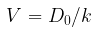（其中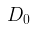是未来无限时期支付的每股股利，k是必要收益率）。 已知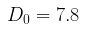元，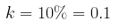。2. 然后计算股票价值： 股票价值V = 7.8÷0.1 = 78元。3. 最后求股票投资价值和市价之差： 股票投资价值（78元）与市价（80元）之差为78 - 80 = - 2元。答案：B

**3.（单选题）** 研究和发现股票的（），并将其与市场价格比较，进而决定投资策略是证券分析师的主要任务。
A.票面价值
B.账面价值
C.清算价值
D.内在价值
**答案：** D
**解析：** 证券分析师主要通过研究股票内在价值，与市场价格对比来决定投资策略。票面价值是股票标明的金额；账面价值是每股净资产；清算价值是公司清算时每股所代表的实际价值，这几个价值对投资策略的决定意义不如内在价值。答案选D。

**4.（单选题）** 下列关于P/E和EV/EBITDA的说法中，错误的是（　）。
A.在EV/EBITDA方法中，要最终得到对股票市值的估计，还必须减去债权的价值
B.P/E和EV/EBITDA反映的都是市场价值和收益指标之间的比例关系
C.P/E是从全体投资人的角度出发，而EV/EBITDA是从股东的角度出发
D.EV/EBITDA更适用于单一业务或子公司较少的公司估值
**答案：** C
**解析：** P/E即市盈率，是从股东角度出发；EV/EBITDA（企业价值倍数）是从全体投资人角度出发，C选项说法错误。A选项，EV是企业价值，减去债权价值才得到股权价值，即股票市值估计，说法正确；B选项，二者确实都反映市场价值与收益指标比例关系；D选项，EV/EBITDA适用于单一业务或子公司少的公司估值。答案：C

**5.（单选题）** 某上市公司2021年末财务数据以及股票价格如下：净利润24000万元，股本总数80000万股，股票价格7.5元/股。该公司市盈率为（　）。
A.25
B.20
C.30
D.45
**答案：** A
**解析：** 每股收益 = 净利润÷股本总数 = 24000÷80000 = 0.3（元）。市盈率 = 每股价格÷每股收益 = 7.5÷0.3 = 25（倍）。答案：A

> **原题图片（供核对）**
> 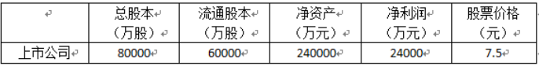

**6.（单选题）** （　）假定，股利是投资者在正常条件下投资股票所直接获得的唯一现金流，则就可以建立估价模型对普通股进行估值。
A.自由现金流贴现模型
B.股权资本自由现金流贴现模型
C.超额收益贴现模型
D.股利贴现模型
**答案：** D
**解析：** 题干强调以股利作为股票投资唯一现金流来对普通股估值，这与股利贴现模型的定义相符，该模型就是基于股利进行股票价值评估。而自由现金流贴现模型关注的是企业整体自由现金流；股权资本自由现金流贴现模型聚焦股权资本可获得的自由现金流；超额收益贴现模型重点在于超额收益，均非基于股利。答案：D

**7.（单选题）** 假设某公司本年每股将派发股利0.2元，以后每年的股利按4%递增，投资必要报酬率为9%，该公司股票的内在价值为（　）元。
A.4.16
B.5.16
C.6
D.8.5
**答案：** A
**解析：** 根据固定增长股票的价值计算公式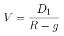，其中V为股票内在价值，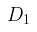是预计下一期的股利，R是投资者要求的必要报酬率，g是股利增长率。 已知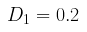元，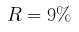，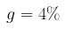。2. 计算： 把数据代入公式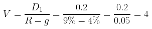（元），但选项中无此答案，应该是公式中是下一期股利，题目中本年派发股利0.2元，下一期股利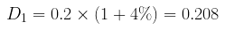元。 重新计算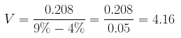元。答案：A

**8.（单选题）** 上年末某公司支付每股股息为8元，预计在未来其股息按每年6%的速度增长，必要收益率为14%，该股票面值为100元，则该公司股票的价值为（　）元。
A.96元
B.98元
C.100元
D.106元
**答案：** D
**解析：** 本题使用股票价值的不变增长模型公式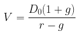，其中V为股票价值，是上年末支付的每股股息，g是股息增长率，r是必要收益率。 已知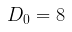元，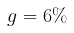，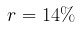。 将数据代入公式可得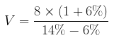。2. 计算过程： 先计算分子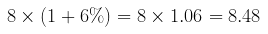。 再计算分母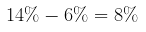，即0.08。 最后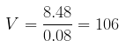（元）。答案：D

**9.（单选题）** 股票的（　）决定股票的市场价格。
A.供求状况
B.内在价值
C.市场价值
D.预期价格
**答案：** B
**解析：** 股票的内在价值是股票未来收益的现值，它是股票价格的基础，股票的市场价格围绕内在价值波动，所以内在价值决定市场价格。答案：B

**10.（单选题）** 某公司每股净资产为2，市净率为4，每股收益为0.5，则市盈率等于（　）。
A.20
B.16
C.8
D.4
**答案：** B
**解析：** 1. 首先明确相关公式： 市净率=每股市价÷每股净资产； 市盈率=每股市价÷每股收益。2. 由市净率公式求每股市价： 已知每股净资产为2，市净率为4，根据市净率公式可得每股市价=市净率×每股净资产 = 4×2 = 8。3. 再由市盈率公式求市盈率： 已知每股收益为0.5，每股市价为8，根据市盈率公式，市盈率 = 每股市价÷每股收益 = 8÷0.5 = 16。答案：B

**11.（单选题）** 有关股票的价值的不包括（　）。
A.票面价值
B.折旧价值
C.清算价值
D.内在价值
**答案：** B
**解析：** 股票价值主要有票面价值、账面价值、清算价值、内在价值等。折旧价值一般用于固定资产等，与股票价值概念不相关。答案：B

**12.（单选题）** 发行价格高于面值称为溢价发行，溢价发行所得的溢价款列为（　）。
A.公司资本公积金
B.股本账户
C.盈余公积
D.留存收益
**答案：** A
**解析：** 溢价发行股票时，超出股票面值的溢价部分应计入公司资本公积金，这是会计处理的规定。答案：A
