# 证券投资基金基础知识 · 第12章 基金业绩评价

## 第1节 基金业绩评价概述（2题）

**1.（单选题）** （　）是指通过一系列科学、系统的量化和定性分析方法，对基金的业绩表现进行全面、客观的衡量、分析和评估的过程。
A.基金风险管理
B.基金业绩评价
C.基金业绩预测
D.基金投资管理
**答案：** B
**解析：** 题干强调对基金业绩表现进行衡量、分析和评估的过程，这与基金业绩评价的概念相符。基金风险管理侧重于风险控制；基金业绩预测是对未来业绩推测；基金投资管理是对资金投资运作。答案选B。

**2.（单选题）** 基金业绩评价应考虑的因素不包括（　）。
A.基金的绝对收益
B.业绩的时期区间
C.基金管理规模
D.风险调整后收益
**答案：** A
**解析：** 基金业绩评价需综合考量多方面。风险调整后收益能兼顾收益与风险，业绩的时期区间能反映不同阶段表现，基金管理规模会对业绩有影响。而绝对收益未考虑风险等其他关键因素，不能全面合理评价基金业绩。答案：A

## 第2节 基金业绩评价指标（13题）

**1.（单选题）** 詹森阿尔法是基于（　）模型，通过比较基金投资组合的收益率与相同系统性风险水平下市场组合的收益率，来评估基金经理的表现。
A.MM
B.均值—方差
C.CAPM
D.APT
**答案：** C
**解析：** 詹森阿尔法是在资本资产定价模型（CAPM）基础上发展出的一个风险调整后收益指标，用于衡量基金超出它所承受风险对应的预期收益的部分。答案：C

**2.（单选题）** 基金的（　）指在一定时间区间内，基金收益超出业绩比较基准收益的部分。
A.相对收益
B.绝对收益
C.平均收益
D.标准收益
**答案：** A
**解析：** 相对收益是与业绩比较基准对比超出的部分；绝对收益不依赖业绩比较基准；平均收益是一段时间内收益平均值；标准收益这种说法较少。题干描述符合相对收益定义。答案：A

**3.（单选题）** 几何收益率通常（　）算术平均收益率。
A.大于
B.等于
C.小于
D.不确定
**答案：** C
**解析：** 由于收益率波动的影响，几何平均收益率考虑了资金的时间价值和复利效应，而算术平均收益率没有考虑这些。在存在收益率波动的情况下，几何平均收益率会小于算术平均收益率。只有当收益率没有波动，即各期收益率相等时，两者才相等，但这种情况比较特殊。通常投资收益率是有波动的。答案：C

**4.（单选题）** 基金绝对收益中的平均收益率一般可分为（　）和（　）。
A.持有区间收益率；时间加权收益率
B.算术平均收益率；几何平均收益率
C.资产回报；收入回报
D.平均市盈率；平均市净率
**答案：** B
**解析：** 基金绝对收益中平均收益率常见的分类是算术平均收益率和几何平均收益率。A选项中持有区间收益率和时间加权收益率并非平均收益率的这种分类；C选项资产回报和收入回报是对收益来源的一种划分，不是平均收益率分类；D选项平均市盈率和平均市净率与基金平均收益率无关。答案：B

**5.（单选题）** 假设某基金第一年的收益率为6%，第二年的收益率是10%，其算术平均收益率为（　）。
A.6%
B.8%
C.10%
D.无法判断
**答案：** B
**解析：** 算术平均收益率的计算公式为。 已知第一年收益率为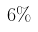，第二年收益率为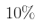，年数为2年。 则算术平均收益率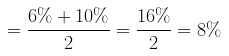。答案：B

**6.（单选题）** （　）将收益率计算区间分为子区间。
A.持有期收益率
B.算数平均收益率
C.几何平均收益率
D.时间加权收益率
**答案：** D
**解析：** 时间加权收益率的计算方法是将收益率计算区间分为子区间，这样可以消除在不同时间点现金流对收益率计算的影响，更准确地反映基金经理的投资管理能力。而持有期收益率是反映投资者在特定持有期间的实际收益；算术平均收益率与几何平均收益率主要侧重于对多期收益率的平均计算方式，并非是将收益率计算区间进行划分。答案：D

**7.（单选题）** 假设某基金第一年的收益率为5%，第二年的收益率也是5%，其年几何平均收益率（　）。
A.小于5%
B.等于5%
C.大于5%
D.无法判断
**答案：** B
**解析：** 当各期收益率相等时，几何平均收益率的计算公式为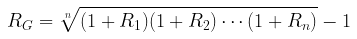（n为期限数，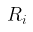为各期收益率）。 这里n = 2，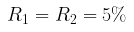，代入公式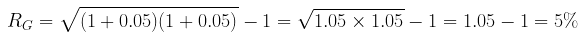 。答案：B

**8.（单选题）** 假设某基金在2012年12月3日的单位净值为1.4848元，2013年9月1日的单位净值为1.7886元。期间该基金曾于2013年2月28日每份额翻派发红利0.275元。该基金2013年2月27日（除息日前天）的单位净值为1.8976元，则该基金在这段时间内的时间加权收益率为（　）。
A.20.88
B.30.88
C.40.88
D.50.88
**答案：** C
**解析：** 1. 首先明确时间加权收益率的计算思路： 时间加权收益率需考虑分红等对净值的影响，分阶段计算收益率，再进行连乘。 第一阶段：从2012年12月3日到2013年2月27日，初始净值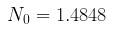元，2013年2月27日净值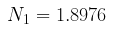元，该阶段收益率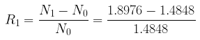。 第二阶段：2013年2月28日分红后净值变为1.8976 - 0.275 = 1.6226元，从2013年2月28日到2013年9月1日，初始净值变为分红后的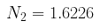元，期末净值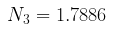元，该阶段收益率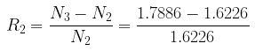。2. 然后计算时间加权收益率R： 根据公式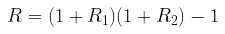。 先算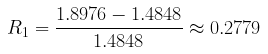；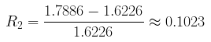。 则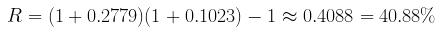。答案选C。

**9.（单选题）** 已知无风险利率、基金收益率及基金收益的标准差，可以计算（　）。
A.夏普比率
B.特雷诺指数
C.卡玛比率
D.信息比率
**答案：** A
**解析：** 夏普比率的计算公式为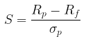，其中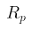是基金收益率，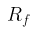是无风险利率，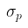是基金收益的标准差，已知无风险利率、基金收益率及基金收益的标准差可以计算夏普比率。 特雷诺指数计算需要用到系统风险（β值），题目未提及，无法计算。 卡玛比率计算需要最大回撤数据，题目未给出，无法计算。 信息比率计算需要基准组合收益率等额外信息，题目未提及，无法计算。答案：A

**10.（单选题）** 考虑下列两种投资策略：策略1 的预期收益率确定为 6%，无风险；策略2 的收益率取值为[6%，15%]。策略__________是有优势的策略，因为_________。（　）
A.1；它有最高的回报／风险比率
B.2；它的收益率至少等于策略1，而有时更高
C.1；它是无风险的
D.2；它具有最高的回报／风险比率
**答案：** B
**解析：** B正确、C错误：策略1的预期收益率确定为6%，策略2的收益率取值为[6%，15%]，因而策略2的预期收益率至少等于策略1，还有可能比策略1的高。
AD错误：如果要对预期收益率进行风险调整，应该像特雷诺比率和夏普比率那样以资产的收益率与无风险利率的差作为分子，而此题中策略1的收益率与无风险收益率的差为0，其标准差也为0，不能求两者的比值，因而不能运用此种方法。
综上，该题选B。

> **原题图片（供核对）**
> 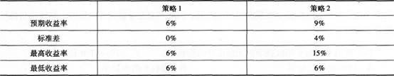

**11.（单选题）** 假设当前无风险收益率为5%，基金P的收益率为40%，标准差为0.5；证券市场的收益率为25%，标准差为0.25。则该基金P的夏普比率为（　）。
A.0.7
B.0.3
C.1.4
D.0.6
**答案：** A
**解析：** 夏普比率的计算公式为：。已知无风险收益率为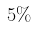，基金P的收益率为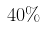，标准差为0.5，直接代入公式计算。2. 计算过程：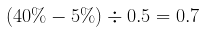。3. 答案：A。

**12.（单选题）** （　）以标准差作为基金风险的度量，给出了单位总风险下超额收益率。
A.特雷诺比率
B.夏普比率
C.信息比率
D.道氏指数
**答案：** B
**解析：** 夏普比率以标准差衡量总风险，反映单位总风险下的超额收益；特雷诺比率用的是系统风险；信息比率是与业绩比较基准相比；道氏指数不是衡量风险收益关系的指标。答案：B

**13.（单选题）** 下列（　）是计算基金信息比率没有用到的变量。
A.基金的β值
B.投资组合收益率
C.跟踪误差
D.业绩比较基准收益率
**答案：** A
**解析：** 信息比率的计算公式为：IR =（投资组合收益率 - 业绩比较基准收益率）/ 跟踪误差。该公式未涉及基金的β值。答案：A

## 第3节 基金业绩归因（3题）

**1.（单选题）** 假设一只股票在考察区间内没有交易和其他费用，其区间涨跌幅为3.05%，初始权重为13.08%，其收益贡献为（　）。
A.0.2%
B.0.3%
C.0.4%
D.0.6%
**答案：** C
**解析：** 收益贡献等于股票的区间涨跌幅乘以其初始权重。即3.05%×13.08%，3.05%约为3%，13.08%约为13%，3%×13%=0.39%，接近0.4%。答案：C

**2.（单选题）** 基金P当月的实际收益率为5.5%。基准投资组合B的相关数据为：股票权重60%、月指数收益率5.81%；债券权重30%、月指数收益率1.45%；现金权重10%、月指数收益率0.48%。基金P的超额收益率为（　）。
A.1.63%
B.1.53%
C.1.52%
D.1.625%
**答案：** B
**解析：** 基准B的当月收益率 = Σ(权重×月指数收益率) = 0.6×5.81% + 0.30×1.45% + 0.1×0.48% = 3.97%。
基金P的月超额收益 = 基金P月实际收益率 − 基准B当月收益率 = 5.5% − 3.97% = 1.53%。答案：B

> **原题图片（供核对）**
> 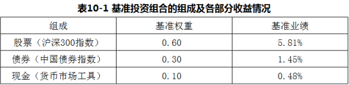

**3.（单选题）** 假设基金p的各项资产权重分别为股票70%、债券7%，股票部分的超额收益率为1.47%，债券部分的超额收益率为0.44%。求基金p行业与证券选择带来的贡献（　）。
A.1.06%
B.1.10%
C.1.08%
D.1.12%
**答案：** A
**解析：** 把股票部分和债券部分中的超额收益率乘以各自的投资比例：
贡献 = 0.70×1.47% + 0.07×0.44% = 1.029% + 0.0308% ≈ 1.06%。答案：A

> **原题图片（供核对）**
> 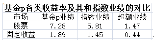

## 第4节 基金风格分析（3题）

**1.（单选题）** （　）是根据基金的实际证券组合构成或对基金业绩的特征分析来判别其投资风格。
A.事前分析
B.事中分析
C.事后分析
D.局部分析
**答案：** C
**解析：** 事后分析是基于基金实际表现和实际证券组合构成等去判别投资风格，而事前分析主要是依据基金招募说明书等事先资料判断。题中说根据实际证券组合构成或对基金业绩特征分析判别风格，这属于事后分析。答案：C

**2.（单选题）** 关于基于组合构成的基金投资风格分析方法，以下说法正确的是（　）。
A.通过分析基金历史收益率来确定投资风格
B.首先将市场上的证券按市值、市盈率等特征值进行分类
C.仅适用于债券型基金的投资风格分析
D.完全依赖基金经理的主观判断来确定投资风格
**答案：** B
**解析：** 基于组合构成的基金投资风格分析，是先把市场上的证券按市值、市盈率等特征值分类，然后看基金投资组合中各类证券的比例来确定其风格。 A选项分析历史收益率确定投资风格不属于基于组合构成的分析方法；C选项不仅适用于债券型基金，股票型等基金也适用；D选项不是完全依赖基金经理主观判断。答案：B

**3.（单选题）** 以下关于基于收益特征的风格分析的表述，正确的有（　）。
Ⅰ.运用多因子模型来确定基金投资风格
Ⅱ.通常要求20~36个月的业绩数据
Ⅲ.不适用于新成立的基金
Ⅳ.能有效检验基金短期的风格变化
A.Ⅰ、Ⅱ、Ⅲ
B.Ⅰ、Ⅱ、Ⅳ
C.Ⅰ、Ⅲ、Ⅳ
D.Ⅱ、Ⅲ、Ⅳ
**答案：** A
**解析：** 运用多因子模型来确定基金投资风格是基于收益特征风格分析的常见方法，Ⅰ正确。 基于收益特征的风格分析通常要求20 - 36个月的业绩数据来较为准确地判断风格，Ⅱ正确。 新成立基金由于业绩数据不足，这种基于收益特征依赖一定期限业绩数据的风格分析不适用于它，Ⅲ正确。 基于收益特征的风格分析主要依赖较长时间业绩数据，对短期风格变化检验效果不佳，Ⅳ错误。答案：A

## 第5节 基金管理人分析（4题）

**1.（单选题）** 投资者和基金评价机构可通过多种公开渠道关注基金管理人的合规表现，以下不属于此类公开渠道的是（　）。
A.中国证监会的处罚决定
B.基金产品定期报告
C.基金管理人内部会议纪要
D.交易所发布的相关公告
**答案：** C
**解析：** 基金管理人内部会议纪要属于内部资料，不对外公开。而中国证监会处罚决定、基金产品定期报告、交易所发布的相关公告都属于公开渠道信息。答案：C

**2.（单选题）** 根据监管规定，基金管理公司的独立董事人数不得少于（　）人，且不得少于董事会人数的（　）。
A.3；1/2
B.2；1/3
C.3；1/3
D.2；1/2
**答案：** C
**解析：** 这是关于基金管理公司独立董事人数及占董事会人数比例的规定记忆题，需牢记相关标准。答案为C，基金管理公司独立董事人数不得少于3人，且不得少于董事会人数的1/3 。

**3.（单选题）** 以下属于基金公司经营能力主要体现在（　）。
Ⅰ.管理规模
Ⅱ.产品结构
Ⅲ.创新能力
Ⅳ.客户构成
A.Ⅰ、Ⅱ、Ⅲ
B.Ⅰ、Ⅱ、Ⅳ
C.Ⅰ、Ⅲ、Ⅳ
D.Ⅰ、Ⅱ、Ⅲ、Ⅳ
**答案：** D
**解析：** 基金公司的经营能力体现在综合实力的多个核心维度：Ⅰ. 管理规模直接反映市场对其投研能力与品牌的认可度，是衡量行业地位和盈利能力的关键指标；Ⅱ. 合理的产品结构（覆盖多类型基金、满足不同需求）体现对市场的把握与业务布局的全面性；Ⅲ. 产品设计、投研技术等方面的创新能力能帮助突破竞争壁垒、抢占先机，是发展核心动力；Ⅳ. 客户构成的多样性及黏性关系到资金来源稳定性与业务可持续性，反映市场接纳度。因此 Ⅰ、Ⅱ、Ⅲ、Ⅳ 均属于经营能力的主要体现，答案选 D。

**4.（单选题）** 基金管理人的核心竞争力是（　）。
A.销售能力
B.投研能力
C.风控能力
D.运营能力
**答案：** B
**解析：** 基金管理人主要职责是对基金资产进行投资运作，为投资者获取收益。投研能力是对投资标的深入研究、精准把握投资机会并做出合理投资决策的关键，直接关乎基金业绩表现，是核心竞争力。销售、风控、运营能力虽重要，但相比之下，投研处于核心地位。答案：B

## 第6节 基金评价业务体系（3题）

**1.（单选题）** 2010年5月，获得首批基金评价业务资质的机构类型包括（　）。
Ⅰ.证券公司
Ⅱ.独立基金评价机构
Ⅲ.证券投资咨询机构
Ⅳ.媒体
A.Ⅰ、Ⅱ、Ⅲ
B.Ⅰ、Ⅱ、Ⅳ
C.Ⅰ、Ⅲ、Ⅳ
D.Ⅰ、Ⅱ、Ⅲ、Ⅳ
**答案：** D
**解析：** 根据中国证监会 2009 年发布的《证券投资基金评价业务管理暂行办法》，基金评价业务资质的申请主体包括证券公司、证券投资咨询机构、独立基金评价机构以及其他经中国证监会认定的机构。2010 年 5 月，中国证监会公布了首批获得基金评价业务资质的机构名单，涵盖了证券公司（如银河证券）、独立基金评价机构（如晨星中国）、证券投资咨询机构（如天相投顾）以及媒体类机构（如中国证券报社）等多种类型。因此，Ⅰ、Ⅱ、Ⅲ、Ⅳ 均属于首批获得资质的机构类型，答案选 D。

**2.（单选题）** 基金评价业务（　）要求基金评价标准、方法和程序保持一致，不得使用未经公开披露的评价标准、方法和程序。
A.公正性原则
B.一致性原则
C.客观性原则
D.公开性原则
**答案：** B
**解析：** 题干强调基金评价标准、方法和程序要保持一致，这体现的就是一致性原则。答案：B

**3.（单选题）** 基金分类作为基金业绩评价的基础和核心环节，其重要性主要体现在（　）。
Ⅰ.确保评价的公平性和可比性
Ⅱ.提高评价的精确度和专业性
Ⅲ.满足投资者的差异化需求
Ⅳ.促进行业的规范发展
A.Ⅰ、Ⅱ、Ⅲ
B.Ⅰ、Ⅱ、Ⅳ
C.Ⅱ、Ⅲ、Ⅳ
D.Ⅰ、Ⅱ、Ⅲ、Ⅳ
**答案：** D
**解析：** 基金分类对确保评价公平可比很关键，不同类别基金不能简单放一起比，Ⅰ正确；准确分类能提高评价精准度与专业性，因为不同类型基金特点不同，Ⅱ正确；投资者需求多样，按类别能满足差异化需求，Ⅲ正确；规范分类能让行业发展更有序，促进行业规范发展，Ⅳ正确。答案选D.Ⅰ、Ⅱ、Ⅲ、Ⅳ 。

## 第7节 全球投资业绩标准（4题）

**1.（单选题）** 以下关于全球投资业绩标准的收益率计算说法错误的是（　）。
A.必须采用总收益率，即包括已实现和未实现的资本利得与损失，并加上所有投资收入
B.投资组合的收益必须使用组合群内各个投资组合的期初资产市值(或期初资产市值加上期间加权现金流)作为权重进行加权平均计算
C.在计算总收益时，必须计入投资组合中持有的现金及现金等价物及其产生的收益
D.所有的收益计算不扣除期间内实际发生的直接交易费用，但不得使用估计的交易费用
**答案：** D
**解析：** 全球投资业绩标准要求所有的收益计算必须扣除期间内实际发生的直接交易费用和间接费用，不能不扣除，D 选项说法错误。A、B、C 选项说法均正确。答案：D

**2.（单选题）** 关于全球投资业绩标准(GIPS)的制定目标，以下表述正确的是（　）。
Ⅰ.维护投资者利益，建立信任
Ⅱ.确保业绩数据的准确性、一致性和可比性
Ⅲ.提供全球统一的投资业绩报告框架
Ⅳ.推动行业的自律和专业化
A.Ⅰ、Ⅱ
B.Ⅰ、Ⅱ、Ⅲ
C.Ⅱ、Ⅲ、Ⅳ
D.Ⅰ、Ⅱ、Ⅲ、Ⅳ
**答案：** D
**解析：** GIPS制定目标是多方面的。维护投资者利益，建立信任是其重要出发点，因为准确可比的业绩数据能让投资者更好决策，增强对行业信任，Ⅰ正确；确保业绩数据的准确性、一致性和可比性，这样不同投资机构业绩才能公平比较，Ⅱ正确；提供全球统一的投资业绩报告框架，利于全球范围内业绩交流和评估，Ⅲ正确；推动行业的自律和专业化，通过统一标准促使行业自我规范和提升专业度，Ⅳ正确。答案：D.Ⅰ、Ⅱ、Ⅲ、Ⅳ

**3.（单选题）** 关于全球投资业绩标准(GIPS)的遵守要求，以下说法正确的是（　）。
A.GIPS是法律强制要求，所有投资机构必须遵守
B.机构可以选择性遵守GIPS标准的部分条款
C.当GIPS与当地法律冲突时，机构必须优先遵守GIPS标准
D.机构一旦宣称遵守GIPS，就必须满足所有适用要求
**答案：** D
**解析：** GIPS不是法律强制要求，是自愿遵守的；机构不能选择性遵守部分条款；当GIPS与当地法律冲突时，应优先遵守当地法律。而机构一旦宣称遵守GIPS，就必须满足所有适用要求。答案：D

**4.（单选题）** 根据GIPS对输入数据的规定，自2011年1月1日起，投资组合必须以（　）进行估值。
A.历史成本
B.公允价值
C.摊余成本
D.市场均价
**答案：** B
**解析：** GIPS规定自2011年1月1日起，投资组合必须以公允价值进行估值，以确保估值的客观性和准确性。答案：B
