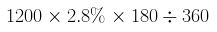
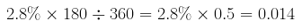

# 证券投资基金基础知识 · 第14章 基金的投资交易与结算

## 第1节 基金参与证券交易所二级市场的交易与结算（22题）

**1.（单选题）** 目前，上海证券交易所、深圳证券交易所和北京证券交易所A股过户费均按照成交金额乘以所征收费率计算，并向买卖双方投资者分别收取。对于优先股交易的登记过户费，均按照普通股下调（　）向买卖投资双方分别收取。
A.10％
B.15％
C.20％
D.50％
**答案：** C
**解析：** 这是关于证券交易过户费收费标准的记忆性知识点，需记住优先股交易登记过户费按普通股下调20％向买卖双方收取。答案：C

**2.（单选题）** 下列关于PROP和D-COM系统的表述，不正确的是（　）。
A.PROP是中国结算公司深圳分公司建立的电子数据交换系统
B.PROP系统中，结算参与人交收头寸及最低备付不足的应及时向备付金账户补入资金
C.结算参与人在中国结算公司上海分公司的备付金账户中有超额备付时，可根据需要将资金划到经授权的预留银行收款账户
D.结算参与人可通过D-COM系统实时查询各资金结算账户余额等信息
**答案：** A
**解析：** PROP是中国结算公司上海分公司建立的电子数据交换系统，不是深圳分公司，A表述错误。B、C、D表述均正确。答案：A

**3.（单选题）** 上海证券交易所固定收益平台的交易，交易商当日买入的固定收益证券，（　）可以卖出，当日被待交收处理的固定收益证券，（　）可以卖出。
A.当日；当日
B.当日；下一交易日
C.下一交易日；当日
D.下一交易日；下一交易日
**答案：** B
**解析：** 上海证券交易所固定收益平台交易规则规定，交易商当日买入的固定收益证券，当日可以卖出；当日被待交收处理的固定收益证券，下一交易日可以卖出。答案：B

**4.（单选题）** 下列不属于场内证券交易结算原则的是（　）。
A.自然人结算原则
B.法人结算原则
C.共同对手方制度
D.货银对付原则
**答案：** A
**解析：** 场内证券交易结算原则主要有法人结算原则、共同对手方制度、货银对付原则等，不存在自然人结算原则。答案选A。

**5.（单选题）** 逐笔全额结算的主要特点不包括（　）。
A.资金的足额以单笔交易为最小单位，资金足额则全部交收，不足则全不交收
B.交收期灵活，从实时逐笔全额到交收期为T+0～T+n日不等
C.交收方式多样，结算参与人可以根据需要采用货银对付、纯券过户等多种交收方式
D.对证券的清算只计每一种证券应收、应付相抵后的净额
**答案：** D
**解析：** 选项A、B、C描述的都是逐笔全额结算的特点。 选项D中“对证券的清算只计每一种证券应收、应付相抵后的净额”，这是净额结算的特点，并非逐笔全额结算的特点。答案：D

**6.（单选题）** 证券和资金结算实行（　）原则。
A.全额结算
B.分级结算
C.分期付款
D.净额清算
**答案：** B
**解析：** 证券和资金结算实行分级结算原则，分级结算是指证券登记结算机构与证券公司等结算参与人进行资金和证券的法人结算（又称一级结算）；证券公司再与客户进行二级结算。这是我国结算制度的重要原则。而全额结算、分期付款并非证券和资金结算主要实行原则，净额清算只是结算方式的一种，并非原则。答案：B

**7.（单选题）** 证券不能产生开盘价的，以（　）产生。
A.集合竞价方式
B.前一日收盘价
C.连续竞价方式
D.交易所决定
**答案：** C
**解析：** 若证券不能产生开盘价，就以连续竞价方式产生。集合竞价是产生开盘价的方式，但前提是能产生开盘价的情况；前一日收盘价不会直接成为当日开盘价；交易所决定过于宽泛不准确。所以选连续竞价方式。答案：C

**8.（单选题）** 在我国，证券交易所是（　）。
A.实行自律管理的法人
B.以营利为目的的法人
C.不以证券营利为目的的机关
D.实行自律管理的机关
**答案：** A
**解析：** 我国证券交易所是为证券集中交易提供场所和设施，组织和监督证券交易，实行自律管理的法人。它并非以营利为目的，也不是机关单位。答案：A

**9.（单选题）** 在我国，证券交易所的设立和解散，由（　）决定。
A.国务院
B.证监会
C.中国人民银行
D.证券交易所
**答案：** A
**解析：** 在我国，证券交易所作为重要金融市场基础设施，其设立和解散属于重大事项，需由国务院决定，这是国家宏观层面的决策安排。答案：A 。

**10.（单选题）** 一般情况下，通过证券交易所达成的交易需采取（　）方式。
A.净额结算
B.全额结算
C.双边净额清算
D.单边净额清算
**答案：** A
**解析：** 证券交易结算方式有全额结算和净额结算两种，一般情况下，通过证券交易所达成的交易采用净额结算，净额结算又分为双边净额清算和多边净额清算，通常所说的净额结算是多边净额结算，相比全额结算效率更高等优势适合交易所大量交易情况。 答案：A

**11.（单选题）** 下列属于证券交收环节的是（　）。
A.投资者与投资者之间的证券交收
B.证券公司与结算参与人之间的证券交收
C.结算参与人与客户之间的证券交收
D.结算参与人与结算参与人之间的证券交收
**答案：** C
**解析：** 证券交收实际是结算参与人与客户之间的证券交收，结算参与人负责办理与客户之间的证券交收。而投资者之间、证券公司与结算参与人之间、结算参与人与结算参与人之间不存在证券交收环节这种说法。答案选C。

**12.（单选题）** 证券交易所证券交易当日无成交的，以（　）为当日收盘价。
A.一周收盘价
B.一周开盘价
C.前收盘价
D.前开盘价
**答案：** C
**解析：** 证券交易所证券交易当日无成交时，按照规定以 前收盘价为当日收盘价 。答案：C

**13.（单选题）** （　）指结算公司对买卖双方的交易进行轧差清算，形成应收资金(证券)净额和应付资金(证券)净额。
A.净额结算
B.全额结算
C.双边净额结算
D.多边净额结算
**答案：** C

**14.（单选题）** （　）是会员制证券交易所的决策机构。
A.会员大会
B.理事会
C.专门委员会
D.总经理
**答案：** B
**解析：** 会员大会是会员制证券交易所的最高权力机构，理事会是决策机构，专门委员会辅助理事会工作，总经理负责日常事务。答案：B

**15.（单选题）** 关于证券公司向客户收取的佣金标准，下列表述错误的是（　）。
A.佣金的收费标准因交易品种、交易场所的不同而有所差异
B.交易佣金标准由证券交易所制定
C.不得低于代收的证券交易监管费和证券交易所手续费
D.交易佣金标准备案1个月内无异议则正式实施
**答案：** D
**解析：** 依据《关于调整证券交易佣金收取标准的通知》，证券公司向客户收取的佣金不得高于证券交易金额的3‰，也不得低于代收的证券交易监管费和证券交易所手续费等（A、C正确）；佣金的收费标准因交易品种、交易场所的不同而有所差异，股票、基金的交易佣金实行最高上限向下浮动制度，国债现券、企业债及新的交易品种的佣金标准由证券交易所制定并报中国证监会和原国家计委备案（B正确）；交易佣金标准报备后，备案15天内无异议后方可正式实施，而非"备案1个月内无异议则正式实施"，D表述错误。本题选D。

**16.（单选题）** 为防范证券结算风险，我国设立了（　），用于垫付或弥补因违约交收、技术故障、操作失误、不可抗力等造成的证券登记结算机构的损失。
A.证券结算风险基金
B.证券交易风险基金
C.管理风险准备金
D.投资者保护基金
**答案：** A
**解析：** 我国设立证券结算风险基金，目的就是用于垫付或弥补因各种特定原因造成证券登记结算机构的损失。答案：A

**17.（单选题）** （　）是指在证券交易所内按一定的时间、一定的规则集中买卖已发行证券而形成的市场。
A.场内证券交易市场
B.场外证券交易市场
C.柜台证券交易市场
D.OTC
**答案：** A
**解析：** 题目强调在证券交易所内集中买卖已发行证券形成的市场，这符合场内证券交易市场的定义。场外证券交易市场（OTC）、柜台证券交易市场都不在证券交易所内。答案：A。

**18.（单选题）** 证券按集合竞价产生开盘价后，未成交的买卖申报（　）。
A.失效，需要重新申报
B.有效，自动进入连续竞价
C.有效，选择连续竞价或集合竞价
D.有效，继续集合竞价
**答案：** B
**解析：** 证券按集合竞价产生开盘价后，未成交的买卖申报依然有效，会自动进入连续竞价阶段。答案：B

**19.（单选题）** 证券交易所应当创造（　）的市场环境，保证证券交易所的职能正常发挥。
A.公开、公平、公正
B.公开、及时、正确
C.积极、有效、公正
D.公开、公平、及时
**答案：** A
**解析：** 证券交易所的基本原则就是要营造公开、公平、公正的市场环境，这是保证其职能正常发挥的关键。答案：A

**20.（单选题）** 下列关于证券交易所的说法正确的是（　）。
A.证券交易所可以持有证券
B.证券交易所可以进行证券的买卖
C.证券交易所决定证券交易的价格
D.证券交易所的组织形式有会员制和公司制两种
**答案：** D
**解析：** 证券交易所本身不能持有、买卖证券，也不决定证券交易价格，它是为证券交易提供场所和设施等服务的非营利或营利组织，组织形式有会员制和公司制两种。答案：D

**21.（单选题）** 设立证券登记结算机构必须经（　）批准。
A.证券交易所
B.会员大会
C.国务院
D.国务院证券监督管理机构
**答案：** D
**解析：** 证券登记结算机构的设立关乎证券市场的规范与安全，其审批需专门的证券监管部门负责。国务院证券监督管理机构承担证券市场监管职责，设立证券登记结算机构须经其批准。答案：D

**22.（单选题）** 证券经纪商向客户收取的佣金（包括代收的证券交易监管费和证券交易所手续费等）不得高于证券交易金额的（　）。
A.3%
B.3‰
C.5%
D.5‰
**答案：** B
**解析：** 这是关于证券经纪商收取佣金上限规定的记忆题，证券经纪商向客户收取的佣金不得高于证券交易金额的3‰ 。答案：B

## 第2节 基金参与银行间债券市场的交易与结算（19题）

**1.（单选题）** 下列选项中，不属于全国银行间同业拆借中心主要职能的是（　）。
A.拟定债券市场发展规划
B.为市场的投资者提供报价平台
C.为市场的投资者提供电子成交登记服务
D.对通过交易系统开展的债券交易活动进行监测
**答案：** A
**解析：** 拟定债券市场发展规划一般是监管部门等宏观层面的职能，而全国银行间同业拆借中心主要侧重于提供交易相关服务，如报价平台、成交登记、交易监测等。答案：A

**2.（单选题）** 下列选项中，（　）不属于银行间债券市场的交易制度。
A.公开市场一级交易商制度
B.做市商制度
C.共同对手方制度
D.结算代理制度
**答案：** C
**解析：** 银行间债券市场交易制度有公开市场一级交易商制度、做市商制度、结算代理制度。而共同对手方制度是场内证券交易清算与交收的原则，不属于银行间债券市场交易制度。答案：C

**3.（单选题）** 公开市场一级交易商制度，是指（　）根据规定遴选符合条件的债券二级市场参与者作为其对手方，与之进行债券交易。
A.中国人民银行
B.中国证监会
C.证券交易所
D.中国银行
**答案：** A
**解析：** 公开市场业务是中央银行吞吐基础货币，调节市场流动性的主要货币政策工具，公开市场一级交易商制度中，是中国人民银行遴选对手方进行债券交易。答案选A。

**4.（单选题）** 下列关于银行间债券市场的交易制度的说法中，正确的是（　）。
Ⅰ公开市场一级交易商制度是指中国人民银行与根据规定选出的对手方进行债券交易，以实现货币政策目标
Ⅱ做市商制度中，特许交易商不断向投资者报出某些特定债券的买卖价格，以其自有资金和债券与投资者进行交易
Ⅲ结算代理制度中，所有金融机构法人为市场其他参与者办理债券结算业务
Ⅳ结算代理制度中，经中国人民银行批准可以开展结算代理业务的金融机构法人为市场其他参与者办理债券结算业务
A.Ⅰ、Ⅱ
B.Ⅰ、Ⅱ、Ⅳ
C.Ⅱ、Ⅲ、Ⅳ
D.Ⅰ、Ⅱ、Ⅲ、Ⅳ
**答案：** B
**解析：** 公开市场一级交易商制度就是央行与特定对手方交易实现货币政策目标，Ⅰ正确；做市商制度里特许交易商用自有资金和债券与投资者按报出价格交易，Ⅱ正确；结算代理制度是经央行批准可开展该业务的金融机构法人为其他参与者办债券结算业务，不是所有金融机构法人，Ⅲ错误，Ⅳ正确。答案选B。

**5.（单选题）** 关于中央结算公司的职能，下列说法错误的是（　）。
Ⅰ主要为市场的发行人、投资人等各类参与主体提供国债、金融债券、企业债券和其他固定收益证券的发行、登记、托管、交易结算、信息发布等服务
Ⅱ负责维护中债综合业务平台的正常运行
Ⅲ为银行间市场提供以中央对手净额清算为主的直接和间接的本、外币清算服务
Ⅳ为市场的投资者提供报价平台
A.Ⅰ、Ⅱ
B.Ⅰ、Ⅲ
C.Ⅲ、Ⅳ
D.Ⅰ、Ⅲ、Ⅳ
**答案：** C
**解析：** 中央结算公司主要为市场的发行人、投资人等各类参与主体提供国债、金融债券、企业债券和其他固定收益证券的发行、登记、托管、交易结算、信息发布等服务并负责维护中债综合业务平台的正常运行，Ⅰ、Ⅱ表述正确；为银行间市场提供以中央对手净额清算为主的直接和间接的本、外币清算服务是上海清算所的职能，Ⅲ错误；为市场的投资者提供报价平台是外汇交易中心的职能，Ⅳ错误。答案：C

**6.（单选题）** 根据债券交易和结算的相互关系，债券结算可分为（　）。
A.全额结算和净额结算
B.实时处理交收和批量处理交收
C.实时处理交收和净额结算
D.批量处理交收和全额结算
**答案：** A
**解析：** 按债券交易和结算的相互关系，债券结算分为全额结算和净额结算；按结算指令的处理方式，分为实时处理交收和批量处理交收。题目问的是按债券交易和结算相互关系的分类。答案：A

**7.（单选题）** 按照中国人民银行的规定，任何一家市场参与者待返售债券总余额应小于其在债券登记托管结算机构托管的自营债券总量的（　）。
A.100%
B.300%
C.200%
D.50%
**答案：** C
**解析：** 这是关于债券交易规则中待返售债券余额与自营债券总量比例规定的常识题，记住中国人民银行规定待返售债券总余额应小于在债券登记托管结算机构托管的自营债券总量的200%即可。答案：C

**8.（单选题）** 全国银行间债券市场的质押式回购期限最长为（　）。
A.3个月
B.4个月
C.6个月
D.1年
**答案：** D
**解析：** 全国银行间债券市场的质押式回购期限最长为1年 。答案：D

**9.（单选题）** 买断式回购期间资金融出方（　）获得回购期间债券的所有权和使用权。
A.可以
B.不可以
C.经融资方同意后才可以
D.经交易所同意后才可以
**答案：** A
**解析：** 买断式回购中，资金融出方在回购期间是获得债券所有权和使用权的，这是买断式回购与质押式回购的重要区别。答案：A

**10.（单选题）** 任何一家外资金融机构在中国境内的分支机构的远期交易净买入总余额不得超过其人民币营运资金的（　）。
A.40%
B.60%
C.80%
D.100%
**答案：** D
**解析：** 这是关于外资金融机构在中国境内分支机构远期交易净买入总余额与人民币营运资金比例限制的规定，属于记忆性知识点。记住相关比例100%即可。答案：D

**11.（单选题）** 下列关于银行间债券市场的交易方式，表述不正确的是（　）。
A.买断式回购由正回购方向逆回购方支付到期资金结算额，同时逆回购方解除在回购债券上设定的质权的交易
B.远期交易的市场参与者应为进入全国银行间债券市场的机构投资者
C.银行间债券市场交易以询价方式进行，自主谈判，逐笔成交
D.进行债券交易，应订立书面形式的合同
**答案：** A
**解析：** 买断式回购是正回购方将债券卖给逆回购方的同时，双方约定在未来某一日期，正回购方再以约定价格从逆回购方买回相等数量同种债券的交易行为，到期时正回购方支付到期资金结算额并收回债券，逆回购方得到资金，并非解除在回购债券上设定的质权，质押式回购才有债券质押，买断式回购债券所有权发生转移。而B选项，远期交易参与者确实是全国银行间债券市场机构投资者；C选项，银行间债券市场以询价、逐笔成交方式进行；D选项，债券交易需订立书面合同。答案：A

**12.（单选题）** （　）主要为市场的发行人、投资人等各类参与主体提供国债、金融债券、企业债券和其他固定收益证券的发行、登记、托管、交易结算、信息发布等服务。
A.中央结算公司
B.上海清算所
C.全国银行间同业拆借中心
D.中国人民银行
**答案：** A
**解析：** 中央结算公司主要为市场各类参与主体提供国债等固定收益证券的发行、登记、托管等一系列服务。上海清算所主要是为银行间市场提供以中央对手净额清算为主的直接和间接的本外币清算服务等；全国银行间同业拆借中心主要提供银行间本币交易等服务；中国人民银行是央行，职能并非专门提供这些证券相关具体服务。所以答案是A选项。答案：A

**13.（单选题）** （　）履行监督管理银行间债券市场职能。
A.中国人民银行
B.证监会
C.证券业协会
D.银监会
**答案：** A
**解析：** 中国人民银行负责监督管理银行间债券市场。证监会主要监管证券市场等；证券业协会是自律组织；银监会（现银保监会）侧重银行业金融机构监管等。所以答案是与银行间债券市场监管关联紧密的中国人民银行。答案：A

**14.（单选题）** 银行A因急需1200万元资金头寸，将持有的部分利率债券质押给银行B，并与银行B签订回购协议，180天后将债券回购，并支付给银行B的利率为2.8%，银行A到期回购价格是（　）。
A.1216.57万元
B.1204.23万元
C.1200.45万元
D.1206.78万元
**答案：** A
**解析：** 1. 首先明确回购价格计算公式： 回购价格 = 本金 + 本金×回购利率×回购期限/360（在金融领域，通常按一年360天计算）。 已知本金是1200万元，回购利率2.8%，回购期限180天。2. 然后计算： 利息 =  先算。 再算1200×0.014 = 16.8（万元）。 回购价格 = 1200 + 16.8 = 1216.8万元，最接近的是A选项1216.57万元。答案：A

**15.（单选题）** 中国人民银行在银行间债券市场推出债券借贷业务是在（　）。
A.2006年11月20日
B.2005年6月15日
C.2003年7月1日
D.2004年9月3日
**答案：** A
**解析：** 中国人民银行在银行间债券市场推出债券借贷业务是在2006年11月20日 。这属于金融市场业务开展时间的记忆性知识点。答案：A

**16.（单选题）** 在质押式回购中，交易双方需要商定的内容不包括（　）。
A.首期结算金额
B.到期结算金额
C.回购债券数量
D.首期交易净价
**答案：** D
**解析：** 质押式回购中，交易双方需商定首期结算金额（A 选项），它与融入资金等相关；要确定到期结算金额（B 选项），这涉及资金本息归还；还得明确回购债券数量（C 选项） 。而质押式回购以百元面值债券的到期购回价进行报价，并非首期交易净价，净价一般用于现券交易报价，与质押式回购商定内容无关。答案：D

**17.（单选题）** 下列关于净额结算的说法错误的是（　）。
A.降低了市场参与者的流动性的需求
B.降低了市场参与者的结算成本
C.降低了市场参与者尤其是做市商投资运用和市场动作的效率
D.实际是一个交易链
**答案：** C
**解析：** 净额结算能减少资金占用，从而降低市场参与者流动性需求和结算成本，A、B 正确；净额结算使得交易流程更简化，提高做市商等市场参与者投资运用和市场运作效率，而非降低，C 错误；净额结算过程实际形成一个交易链，D 正确。答案：C

**18.（单选题）** 某只债券在银行间债券市场交易流通终止的日期称为（　）。
A.交易交割日
B.结算日
C.交易流通终止日
D.截止过户日
**答案：** C
**解析：** 题目问的是债券在银行间债券市场交易流通终止的日期的称呼，根据定义，这就是交易流通终止日。答案：C

**19.（单选题）** 关于银行间债券市场的债券买断式回购业务，下列说法正确的是（　）。
A.买断式回购的结算债券及用于担保的债券均应为单一券种
B.买断式回购的回购债券期限由全国银行间同业拆借中心规定
C.买断式回购期间，交易双方可以换券
D.买断式回购期间，交易双方可以提前赎回
**答案：** A
**解析：** 买断式回购的结算债券及用于担保的债券均应为单一券种，A正确；回购债券期限由交易双方确定，B错误；买断式回购期间，交易双方不得换券、现金交割和提前赎回，C、D错误。答案：A

## 第3节 基金参与其他市场投资的交易与结算（4题）

**1.（单选题）** 具有与中金所进行结算资格的会员有（　）。
Ⅰ.交易会员
Ⅱ.全面结算会员
Ⅲ.特别结算会员
Ⅳ.交易结算会员
A.Ⅰ、Ⅱ、Ⅲ
B.Ⅰ、Ⅱ、Ⅳ
C.Ⅰ、Ⅲ、Ⅳ
D.Ⅱ、Ⅲ、Ⅳ
**答案：** D
**解析：** 交易会员没有与中金所进行结算的资格，全面结算会员、特别结算会员、交易结算会员都具有与中金所进行结算资格。答案：D

**2.（单选题）** 中金所实行的保证金制度中，未被合约占用的保证金被称为（　）。
A.结算准备金
B.交易保证金
C.初始保证金
D.维持保证金
**答案：** A
**解析：** 结算准备金是未被合约占用的保证金，交易保证金是已被合约占用的保证金。初始保证金和维持保证金主要针对期货交易开仓及持仓过程保证金额度设定，与题干描述不符。答案：A。

**3.（单选题）** （　）是指在交易所采用公开的集中交易方式或者中国证监会批准的其他方式进行的以商品期货合约或者期权合约为交易标的的交易活动。
A.金融期货交易
B.商品期货交易
C.证券现货交易
D.外汇保证金交易
**答案：** B
**解析：** 题目中明确提到以商品期货合约或期权合约为交易标的，且在交易所进行相关交易活动，这符合商品期货交易的定义。答案：B

**4.（单选题）** 根据沪港通和深港通业务实施办法，下列哪些情形的联交所上市公司股票将被调入港股通股票？（　）
Ⅰ.恒生综合大型股指数成分股
Ⅱ.恒生综合中型股指数成分股
Ⅲ.恒生综合小型股指数成分股且市值符合要求
Ⅳ.所有在联交所上市的H股
A.Ⅰ、Ⅱ
B.Ⅰ、Ⅱ、Ⅲ
C.Ⅱ、Ⅲ、Ⅳ
D.Ⅰ、Ⅱ、Ⅲ、Ⅳ
**答案：** B
**解析：** 沪港通和深港通中，港股通股票范围包括恒生综合大型股指数成分股、恒生综合中型股指数成分股，以及恒生综合小型股指数成分股且其市值满足一定要求的股票，但不包括所有在联交所上市的H股，有些H股可能不符合调入条件。所以Ⅰ、Ⅱ、Ⅲ正确。答案：B

## 第4节 基金参与海外证券市场投资的交易与结算（5题）

**1.（单选题）** 负责境外资产托管业务的境外资产托管人，其应当满足最近一个会计年度实收资本不少于（　）亿美元或等值货币，或托管资产规模不少于（　）亿美元或等值货币。
A.10；1000
B.10；100
C.5；1000
D.5；100
**答案：** A
**解析：** 这是对境外资产托管人相关资质要求的考查，需要准确记忆境外资产托管人应满足最近一个会计年度实收资本不少于10亿美元或等值货币，且托管资产规模不少于1000亿美元或等值货币。答案：A

**2.（单选题）** 合并成泛欧证券交易所的成员不包括（　）。
A.布鲁塞尔证券交易所
B.巴黎证券交易所
C.阿姆斯特丹证券交易所
D.法兰克福证券交易所
**答案：** D
**解析：** 泛欧证券交易所是由巴黎证券交易所、阿姆斯特丹证券交易所、布鲁塞尔证券交易所合并而成。法兰克福证券交易所不属于合并成泛欧证券交易所的成员。答案选D。

**3.（单选题）** （　）是世界四大证券交易所之一，欧洲最大的证券交易所，历史可追溯至1801年。
A.泛欧证券交易所
B.芝加哥证券交易所
C.伦敦证券交易所
D.欧洲交易所
**答案：** C
**解析：** 首先，题干提到是欧洲最大的证券交易所且历史可追溯至1801年。 泛欧证券交易所成立于2000年，不符合历史追溯至1801年的条件，A排除。 芝加哥证券交易所位于美国，不在欧洲，B排除。 欧洲交易所是欧洲首家跨国交易所，但它成立于2000年，不符合历史条件，D排除。 伦敦证券交易所历史悠久，符合是欧洲最大且历史可追溯至1801年等条件。答案：C

**4.（单选题）** （　）是全球第一个股票电子交易市场。
A.纳斯达克证券交易所
B.上海证券交易所
C.深圳证券交易所
D.法兰克福证券交易所
**答案：** A
**解析：** 纳斯达克证券交易所是全球第一个股票电子交易市场 ，而上海、深圳证券交易所成立时间晚且不是全球第一个；法兰克福证券交易所也不符合这一特征。答案：A

**5.（单选题）** 境内机构投资者可以委托符合一定条件的投资顾问进行境外证券投资，这些条件不包括（　）。
A.在境外设立，经所在国家或地区监管机构批准从事投资管理业务
B.经营投资管理业务达3年以上
C.最近5年没有受到所在国家或地区监管机构的重大处罚
D.最近一个会计年度管理的证券资产不少于100亿美元或等值货币
**答案：** B
**解析：** 境内机构投资者委托的投资顾问需在境外设立，经所在国家或地区监管机构批准从事投资管理业务，且经营投资管理业务达5 年以上（并非3年），最近5 年没有受到所在国家或地区监管机构的重大处罚， 最近一个会计年度管理的证券资产不少于100亿美元或等值货币。答案：B
