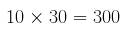
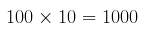
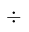
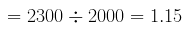
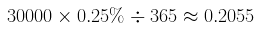
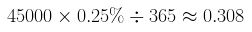

# 证券投资基金基础知识 · 第15章 基金的估值、费用与会计核算

## 第1节 基金资产的估值（16题）

**1.（单选题）** 目前我国封闭式基金的估值频率为（　）。
A.每个交易日估值，每周披露一次份额净值
B.每个交易日估值，次日披露份额净值
C.每日估值，当日披露份额净值
D.每日估值。次日披露份额净值
**答案：** A
**解析：** 封闭式基金一般是每个交易日进行估值，但披露频率相对低，是每周披露一次份额净值。答案：A

**2.（单选题）** 假设某基金持有三种股票的数量分别是10万股、50万股和100万股，每股的收盘价为30元、20元和10元，银行存款为1000万元，对托管人或管理人应付未付的报酬为500万元，应付税费为500万元，已售的基金份额2000万份。计算基金份额净值为（　）元。
A.1
B.1.65
C.0.65
D.1.15
**答案：** D
**解析：** 1. 首先计算基金资产总值： 三种股票市值分别为：（万元），（万元），（万元）。 银行存款1000万元。 基金资产总值=300 + 1000 + 1000 + 1000 = 3300（万元）。2. 接着计算基金负债总值： 应付未付报酬500万元，应付税费500万元，基金负债总值=500 + 500 = 1000（万元）。3. 然后计算基金资产净值： 基金资产净值=基金资产总值-基金负债总值=3300 - 1000 = 2300（万元）。4. 最后计算基金份额净值： 基金份额净值=基金资产净值基金份额（元）。答案：D

**3.（单选题）** 基金日常估值由基金管理人进行。基金管理人每个交易日对基金资产估值后，将基金份额净值结果发给（　）。
A.基金销售机构
B.基金持有人
C.基金托管人
D.基金业协会
**答案：** C
**解析：** 基金管理人对基金资产估值后，要将基金份额净值结果发给基金托管人，由托管人进行复核，二者相互监督制约以保障估值的准确合理。答案：C

**4.（单选题）** 以下关于QDII基金估值规定，正确的有（　）。
A.基金管理公司是QDII基金会计核算和资产估值的责任主体，并负有复核责任
B.基金份额净值应当至少每月结算披露一次
C.基金份额净值应当在估值日后3个工作日内披露
D.基金份额净值应当以人民币或美元等主要外汇货币单独或同时计算并披露
**答案：** D
**解析：** A项中基金管理公司是责任主体，但复核责任通常由托管人承担，A错误；B项，QDII基金份额净值应当至少每周计算并披露一次，不是每月，B错误；C项，基金份额净值应当在估值日后2个工作日内披露，不是3个工作日，C错误；D项，基金份额净值应当以人民币或美元等主要外汇货币单独或同时计算并披露，表述正确。答案：D

**5.（单选题）** 基金管理人虽然必须按规定对基金资产进行估值，但遇到特殊情况，可以暂停估值。这些情况不包括（　）。
A.基金投资所涉及的证券交易所遇法定节假日暂停营业
B.基金投资所涉及的证券交易所因其它原因暂停营业
C.因不可抗力致使基金管理人、基金托管人无法准确评估基金资产价值
D.基金持有人要求暂停基金估值时
**答案：** D
**解析：** 基金估值暂停通常是由于外部客观因素影响，像证券交易所的特殊状况（法定节假日或其他原因暂停营业），以及不可抗力导致管理人、托管人无法准确评估资产价值等。而基金持有人要求暂停估值并不属于合理的暂停估值情形，基金估值有其既定规则和依据，不会因持有人要求就暂停。答案：D

**6.（单选题）** 基金会计核算中，承担复核责任的是（　）。
A.会计师事务所
B.基金托管人
C.证券投资基金
D.基金管理公司
**答案：** B
**解析：** 在基金会计核算中，基金管理公司负责基金的会计核算，而基金托管人承担复核责任，对基金管理人的核算结果进行复核，以确保核算的准确性。答案：B。

**7.（单选题）** 对QDII基金的净值计算及披露规定正确的是（　）。
A.基金份额净值应当在估值后3个工作日内披露
B.基金份额净值应当在估值后2个工作日内披露
C.基金份额净值应当在估值后5个工作日内披露
D.基金份额净值应当在估值后1个工作日内披露
**答案：** B
**解析：** QDII基金份额净值应当在估值后2个工作日内披露。这是对QDII基金净值披露时间的规定。答案：B

**8.（单选题）** 如经济环境发生重大变化或证券发行人发生影响证券价格的重大事件，使潜在估值调整对前一估值日的基金资产净值的影响在（　）以上的，应对估值进行调整并确定公允价值。
A.0.25%
B.0.30%
C.3%
D.5%
**答案：** A
**解析：** 这是关于基金估值调整触发条件的规定，需记忆潜在估值调整对前一估值日基金资产净值影响达0.25%以上时要进行估值调整并确定公允价值。答案：A

**9.（单选题）** 基金管理公司应履行（　）的责任。
A.审查基金份额申购、赎回价格
B.审查基金资产净值
C.复核基金资产净值
D.计算并公告基金资产净值
**答案：** D
**解析：** 基金管理公司的职责包括对基金资产进行估值等核心工作，计算并公告基金资产净值是其重要责任；而审查基金份额申购、赎回价格以及审查、复核基金资产净值更多是基金托管人的职责。答案：D

**10.（单选题）** 根据《证券投资基金法》的规定，“复核、审查基金资产净值和基金份额申购、赎回价格”的职责应该由（　）承担。
A.基金管理人
B.基金托管人
C.基金份额持有人
D.证监会
**答案：** B
**解析：** 基金托管人的职责之一是复核、审查基金管理人计算的基金资产净值和基金份额申购、赎回价格，起到监督基金管理人的作用。基金管理人负责基金的运作等，基金份额持有人是投资者，证监会是监管机构。所以答案是基金托管人。答案：B

**11.（单选题）** 基金托管人因基金估值错误给基金份额持有人造成损失的，一般应由（　）承担。
A.基金托管人
B.会计师事务所
C.基金注册登记机构
D.基金份额持有人
**答案：** A
**解析：** 基金托管人对基金资产估值负有一定的责任，因自身原因导致基金估值错误给基金份额持有人造成损失，理应由其承担责任。答案：A

**12.（单选题）** 假设某基金某日持有的某三种股票的数量分别为150万股、280万股和370万股，每股的收盘价分别为32元、25元和18元，银行存款为10000万元，对托管人或管理人应付的报酬为3000万元，应付税费为4500万元，已出售的基金份额为20000万份，则基金份额净值为（　）元。
A.1.25
B.1.048
C.1.368
D.1.055
**答案：** B
**解析：** 1. 首先计算基金资产总值： 三种股票市值分别为： 第一种股票市值=150×32 = 4800（万元）； 第二种股票市值=280×25 = 7000（万元）； 第三种股票市值=370×18 = 6660（万元）。 基金资产总值=股票市值总和+银行存款=(4800 + 7000 + 6660)+10000 = 28460（万元）。2. 然后计算基金资产净值： 基金资产净值=基金资产总值-负债=28460-(3000 + 4500)=20960（万元）。3. 最后计算基金份额净值： 基金份额净值=基金资产净值÷基金份额=20960÷20000 = 1.048（元）。答案：B

**13.（单选题）** 基金管理公司和托管人在进行基金估值、计算或复核基金份额净值的过程中，未能遵循相关法律法规规定或基金合同约定，给基金财产或基金份额持有人造成损害的（　）。
A.不承担责任
B.负连带责任
C.分别对各自行为依法承担赔偿责任
D.负全部责任
**答案：** C
**解析：** 基金管理公司和托管人在基金估值等过程中，若未遵循规定或约定致损害，应各自对自身行为负责。答案：C

**14.（单选题）** 假定某基金的总资产为50亿元，总负债为8亿元，发行在外的基金份额总数为40亿份，那么其基金份额净值为（　）元。
A.1.29元
B.1.33元
C.1.05元
D.1.12元
**答案：** C
**解析：** 1. 首先明确基金份额净值计算公式： 基金份额净值=（基金资产净值÷基金总份额）。 而基金资产净值 = 基金总资产 - 基金总负债。2. 然后计算基金资产净值： 已知基金总资产为50亿元，总负债为8亿元，那么基金资产净值 = 50 - 8 = 42亿元。3. 最后计算基金份额净值： 基金总份额为40亿份，基金份额净值 = 42÷40 = 1.05元。答案选C。

**15.（单选题）** 下列关于基金估值的表述错误的是（　）。
A.基金份额净值是按照基金资产净值除以当日基金份额的余额数量计算
B.基金日常估值由基金托管人进行
C.基金管理人每个工作日对基金资产估值后，将基金份额净值结果发给基金托管人
D.基金托管人按基金合同规定的估值方法、时间、程序进行复核，基金托管人复核无误后签章返回给基金管理人
**答案：** B
**解析：** 基金日常估值应由基金管理人进行，而不是基金托管人，B 选项表述错误。A 选项是基金份额净值的正确计算方式；C 和 D 描述的是基金估值过程中管理人估值、托管人复核的流程，表述正确。答案：B

**16.（单选题）** 估值错误的处理不包括（　）。
A.基金管理公司应制定估值及份额净值计价错误的识别及应急方案，当估值或份额净值计价错误实际发生时，基金管理公司应立即纠正
B.基金资产估值错误偏差达到或超过基金资产净值的0.25%时，基金管理公司应当及时向监管机构报告
C.基金资产估值错误偏差达到或超过基金资产净值的0.15%时，基金管理公司应当公告
D.基金管理公司和托管银行因共同行为给基金财产或基金份额持有人造成损害的，应承担连带赔偿责任
**答案：** C
**解析：** 基金资产估值错误偏差达到或超过基金资产净值的0.5%时，基金管理公司应当公告，并报监管机构备案，C选项说达到0.15%就公告错误。答案：C

## 第2节 基金费用（10题）

**1.（单选题）** 假设某封闭式基金6月11日的基金资产净值为30000万元人民币，6月12日的基金资产净值为30125万元人民币，该股票的基金托管费率为0.25％，该年实际天数为365天。则该基金6月12日应计提托管费为（　）万元。
A.0.2256
B.0.2397
C.0.2055
D.0.2396
**答案：** C
**解析：** 1. 首先明确托管费计提公式：每日计提的托管费 = 前一日基金资产净值×托管费率÷当年实际天数。2. 已知6月11日基金资产净值为30000万元，托管费率0.25％，当年实际天数365天。3. 代入公式计算：（万元）。答案：C

**2.（单选题）** 基金托管人的托管费是从（　）中列支的。
A.管理人收益
B.托管人收益
C.基金资产
D.投资者的收益
**答案：** C
**解析：** 基金托管费是指基金托管人为保管和处置基金资产而向基金收取的费用，它是从基金资产中支付的，这样才能保证基金运作费用核算的合理性以及对所有投资者的公平性。答案：C

**3.（单选题）** （　）由证券公司按成交金额的一定比例向基金收取。
A.交易佣金
B.印花税
C.过户费
D.经手费
**答案：** A
**解析：** 交易佣金是证券公司为基金提供证券代理买卖服务，按成交金额一定比例向基金收取的费用 。印花税、过户费、经手费等并非由证券公司收取。答案：A

**4.（单选题）** 基金管理过程中的费用不包括（　）。
A.申购费
B.基金管理费
C.基金托管费
D.持有人大会费用
**答案：** A
**解析：** 申购费是投资者在购买基金时支付的费用，并非基金管理过程中产生的费用。而基金管理费、托管费是基金管理中为管理基金资产、托管基金资产收取的费用，持有人大会费用是基金运作管理中召开大会产生的费用。答案：A

**5.（单选题）** 基金的运作费不包括（　）。
A.过户费
B.持有人大会费
C.审计费
D.上市年费
**答案：** A
**解析：** 运作费是基金运作过程中为保证基金正常运作而发生的费用。过户费是证券交易时支付给证券登记清算机构的费用，不属于基金运作费范畴。而持有人大会费、审计费、上市年费都与基金自身运作相关。答案：A。

**6.（单选题）** 关于基金费用，以下说法不正确的是（　）。
A.基金管理费指基金在进行证券买卖交易时所发生的相关交易费用
B.基金托管费是指基金托管人为基金提供托管服务而向基金收取的费用
C.基金托管费及基金销售服务费均是按前一日基金资产净值的一定比例逐日计提，按月支付
D.基金管理过程中发生的费用，主要包括基金管理费、基金托管费、持有人大会费用等
**答案：** A
**解析：** 基金交易费指基金在进行证券买卖交易时所发生的相关交易费用，而基金管理费是基金管理人管理基金资产而向基金收取的费用，A 选项说法错误。B 对基金托管费解释正确；C 关于托管费和销售服务费计提与支付方式表述正确；D 对基金管理过程中主要费用列举正确。答案：A

**7.（单选题）** 下列（　）列入基金费用。
A.基金管理人和基金托管人因未履行或未完全履行义务导致的费用支出或基金财产的损失
B.基金管理人和基金托管人处理与基金运作无关的事项发生的费用
C.基金合同生效前的相关费用，包括但不限于验资费、会计师和律师费、信息披露等费用
D.基金份额持有人大会费用
**答案：** D
**解析：** A选项中因未履行义务致费用支出或损失不应由基金承担；B选项与基金运作无关事项费用不属于基金费用；C选项基金合同生效前费用一般不列入基金费用；D选项基金份额持有人大会费用是为了基金运作相关事宜，列入基金费用。答案：D

**8.（单选题）** 基金运作费用一般指为保证基金正常运作而发生的应由基金承担的费用，它不包括（　）。
A.上市年费
B.交易佣金
C.审计费用
D.银行汇划手续费
**答案：** B
**解析：** 基金运作费用主要是维持基金运作的一些费用，像上市年费、审计费用、银行汇划手续费都属于此类。而交易佣金是在基金买卖证券等交易过程中产生的费用，不属于运作费用。答案：B

**9.（单选题）** 为保证基金正常运作而发生的，应由基金承担的费用为（　）。
A.基金管理费
B.基金交易费
C.基金托管费
D.基金运作费
**答案：** D
**解析：** 题目强调的是为保证基金正常运作而发生且由基金承担的费用。基金运作费就是为保证基金正常运作而发生的费用。基金管理费是支付给基金管理人的管理报酬；基金交易费是基金在进行证券买卖交易时发生的费用；基金托管费是基金托管人为保管和处置基金资产而向基金收取的费用，这三项虽也是基金承担的费用，但都侧重于特定业务环节，并非像基金运作费那样直接针对保证基金正常运作。答案：D

**10.（单选题）** 假设某封闭式基金11月18日的基金资产净值为45000万元人民币，11月19日的基金资产净值为45125万人民币，该基金的基金托管费率为0.25%，该年实际天数为365天。则该基金11月19日应计提托管费为（　）万元。
A.0.184
B.0.246
C.0.308
D.0.369
**答案：** C
**解析：** 1. 首先明确托管费计提公式：每日计提的托管费 = 前一日基金资产净值×托管费率÷当年实际天数。2. 这里前一日基金资产净值是11月18日的45000万元，托管费率0.25%，当年实际天数365天。3. 代入公式计算：（万元）。答案：C

## 第3节 基金会计核算（6题）

**1.（单选题）** 我国基金的会计年度为公历的（　）。
A.1月1日至12月31日
B.12月31日至次年12月30日
C.1月1日至6月30日
D.6月30日至12月31日
**答案：** A
**解析：** 我国基金的会计年度和我国公历年度一致，公历年度是1月1日至12月31日。答案：A

**2.（单选题）** 目前，我国货币市场基金的收益一般（　）结转损益。
A.逐月
B.按季度
C.逐日
D.根据需要
**答案：** C
**解析：** 货币市场基金收益通常是逐日进行结转损益的，这样能及时反映每日收益情况。答案：C

**3.（单选题）** 基金的财务会计报告通常不包括（　）。
A.季报
B.月报
C.年报
D.周报
**答案：** D
**解析：** 基金财务会计报告一般按季度、年度编制，月报相对少见，周报几乎不存在。所以通常不包括周报，答案选D。

**4.（单选题）** 开放式基金相比于封闭式基金，还需对（　）进行会计核算。
A.基金份额的申购与赎回情况
B.基金份额的价值情况
C.清算备付金利息
D.债券的回购利息
**答案：** A
**解析：** 开放式基金特有的是基金份额的申购与赎回，这是区别于封闭式基金的重要特征，所以需要对其进行会计核算。而基金份额价值、清算备付金利息、债券回购利息，封闭式基金和开放式基金都可能涉及核算。答案：A

**5.（单选题）** 证券投资基金的会计核算主体是（　）。
A.基金份额持有人
B.基金托管人
C.基金管理人
D.证券投资基金
**答案：** D
**解析：** 证券投资基金以证券投资基金为会计核算主体，独立建账、独立核算，基金管理人、托管人等仅履行各自职责，不是核算主体，份额持有人更不是。答案：D

**6.（单选题）** 目前，我国的基金会计分期以（　）为单位，分期反映会计主体的财务状况。
A.日
B.季度
C.月
D.年度
**答案：** A
**解析：** 基金会计分期以日为单位，这样能更及时准确反映基金财务状况。因为基金资产价值波动频繁，按日核算可随时掌握其动态。答案选A。

## 第4节 基金财务会计报告分析（3题）

**1.（单选题）** 下列各项内容可以通过基金财务报告的分析获得的有（　）。
Ⅰ基金分红能力分析
Ⅱ基金持仓结构分析
Ⅲ基金资产估值分析
Ⅳ基金费用情况分析
A.Ⅰ、Ⅱ、Ⅲ
B.Ⅰ、Ⅱ、Ⅳ
C.Ⅱ、Ⅲ、Ⅳ
D.Ⅰ、Ⅱ、Ⅲ、Ⅳ
**答案：** B
**解析：** 基金财务报告分析可了解基金分红能力，通过分析基金收益情况等能判断分红潜力，Ⅰ正确； 能分析基金持仓结构，知晓投资各类资产的比例等，Ⅱ正确； 基金资产估值本身是编制财务报告的基础工作，而财务报告分析重点不在估值计算等方面，Ⅲ不太符合； 可以对基金费用情况进行分析，了解管理费、托管费等各项费用，Ⅳ正确。答案：B

**2.（单选题）** 基金会计报表不包括（　）。
A.所有者权益表
B.资产负债表
C.利润表
D.净资产变动表
**答案：** A
**解析：** 基金会计报表主要有资产负债表、利润表和净资产变动表，没有所有者权益表。答案：A

**3.（单选题）** 基金财务会计报告是指基金对外提供的反映（　）基金的财务状况和（　）的经营成果、现金流量等会计信息的文件。
A.某一会计期间；某一特定日期
B.某一会计期间；某一会计期间
C.某一特定日期；某一会计期间
D.某一特定日期；某一特定日期
**答案：** C
**解析：** 财务状况是特定日期的情况，经营成果、现金流量是某一会计期间的情况。所以是反映某一特定日期基金的财务状况和某一会计期间的经营成果等。答案选C。
